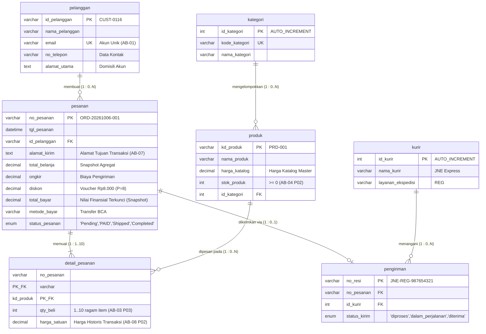

# Tugas Mandiri: Milestone Proyek 4 - Normalisasi Basis Data
**Nama:** Narti Khoirunisa  
**NIM:** 25430116  
**Kelas:** D / Basis Data Praktikum (Semester 3)  
**Tanggal:** 23 Oktober 2026  
**Dosen/Asisten:** Dedi Irawan, S.Kom., M.T.I.  
**Proyek:** Toko Daring Berkah Jaya NK (NisaStore Online)  
**Dokumen Acuan:** `p02_kebutuhan_data_25430116.md` & `p03_laporan_25430116.md`  

---

## 1. Dokumen Sumber Proyek (Titik Awal UNF)

Titik awal proses analisis dan normalisasi data diambil langsung dari dokumen transaksi nyata pada analisis kebutuhan data Pertemuan 2 (`p02_kebutuhan_data_25430116.md`), yaitu **Halaman Pesanan & Resi Pengiriman (Nota Transaksi)** Toko Daring Berkah Jaya NK.

### 1.1 Dokumen Sumber: Halaman Pesanan & Resi Pengiriman (Nota Transaksi)
```text
================================================================================
                          TOKO DARING BERKAH JAYA NK
                    Jl. Ahmad Dahlan No. 16, Metro, Lampung
================================================================================
Nomor Pesanan : ORD-20261006-001
Tanggal Pesan : 06 Oktober 2026 10:30 WIB
Pelanggan     : Budi Santoso (ID: CUST-0116 / Email: budi@email.com / HP: 081298765432)
Alamat Kirim  : Jl. Kenanga Indah Blok C2, Lampung
--------------------------------------------------------------------------------
Kode Produk | Nama Produk          | Qty | Harga Satuan | Subtotal
--------------------------------------------------------------------------------
PRD-001     | Kemeja Flanel Pria   |  1  | Rp 150.000   | Rp 150.000
PRD-002     | Celana Chino Hitam   |  2  | Rp 200.000   | Rp 400.000
--------------------------------------------------------------------------------
Total Belanja            : Rp 550.000
Biaya Ongkir             : Rp  20.000
Voucher Diskon (P=8)     : -Rp  8.000  (Subsidi Belanja Berdasarkan AB-05)
--------------------------------------------------------------------------------
GRAND TOTAL (Total Bayar): Rp 562.000
Metode Bayar             : Transfer Bank BCA
Status Pesanan           : PAID (Lunas)
Ekspedisi & No. Resi     : JNE Express (Resi: JNE-REG-987654321)
================================================================================
```

---

### 1.2 Bentuk Tidak Ternormalisasi (UNF - Unnormalized Form)
Bentuk tidak ternormalisasi (UNF) menampung seluruh atribut data yang tertera pada nota transaksi secara mentah apa adanya. Pada bentuk ini, rincian produk yang dibeli berada dalam satu baris faktur transaksi sebagai atribut bernilai ganda atau kelompok berulang (*repeating group*).

#### Notasi Relasional UNF:
$$\text{UNF} = \{ \text{no\_pesanan}, \text{tgl\_pesanan}, \text{id\_pelanggan}, \text{nama\_pelanggan}, \text{email}, \text{no\_telepon}, \text{alamat\_kirim}, \text{total\_belanja}, \text{ongkir}, \text{diskon}, \text{total\_bayar}, \text{metode\_bayar}, \text{status\_pesanan}, \text{nama\_kurir}, \text{no\_resi}, (\text{kd\_produk}, \text{nama\_produk}, \text{qty\_beli}, \text{harga\_satuan}, \text{subtotal}) \}$$

#### Tabel Representasi Data UNF:
| no_pesanan | tgl_pesanan | id_pelanggan | nama_pelanggan | email | no_telepon | alamat_kirim | total_belanja | ongkir | diskon | total_bayar | metode_bayar | status_pesanan | nama_kurir | no_resi | kd_produk | nama_produk | qty_beli | harga_satuan | subtotal |
| :--- | :--- | :--- | :--- | :--- | :--- | :--- | :--- | :--- | :--- | :--- | :--- | :--- | :--- | :--- | :--- | :--- | :--- | :--- | :--- |
| ORD-20261006-001 | 2026-10-06 10:30 | CUST-0116 | Budi Santoso | budi@email.com | 081298765432 | Jl. Kenanga Indah Blok C2, Lampung | 550000 | 20000 | 8000 | 562000 | Transfer BCA | PAID | JNE Express | JNE-REG-987654321 | PRD-001<br>PRD-002 | Kemeja Flanel Pria<br>Celana Chino Hitam | 1<br>2 | 150000<br>200000 | 150000<br>400000 |

*Catatan: Kolom `kd_produk` hingga `subtotal` merupakan repeating group yang bernilai banyak (multi-valued) dalam satu faktur transaksi pesanan.*

---

## 2. Dependensi Fungsional (FD) dan Kode Aturan Bisnis (AB)

Berdasarkan semantik data, dokumen kebutuhan data (`p02_kebutuhan_data_25430116.md`), dan aturan bisnis proyek (`p03_laporan_25430116.md`), dirumuskan dependensi fungsional berikut:

| Kode FD | Pernyataan Dependensi Fungsional | Jenis Dependensi | Dasar Aturan Bisnis (AB) | Penjelasan Semantik |
| :--- | :--- | :--- | :--- | :--- |
| **FD-01** | `no_pesanan` $\rightarrow$ `tgl_pesanan`, `id_pelanggan`, `alamat_kirim`, `total_belanja`, `ongkir`, `diskon`, `total_bayar`, `metode_bayar`, `status_pesanan` | Penuh (*Full*) | **AB-01**, **AB-07 (P02)**, **AB-01 (P03)** | Satu nomor pesanan unik secara tunggal menentukan tanggal transaksi, identitas pemesan, alamat pengiriman spesifik, komponen biaya, status pembayaran, dan status pemrosesan pesanan. |
| **FD-02** | `id_pelanggan` $\rightarrow$ `nama_pelanggan`, `email`, `no_telepon`, `alamat_utama` | Penuh (*Full*) | **AB-01 (P02)**, **AB-02 (P03)** | Setiap pelanggan terdaftar memiliki ID unik yang menentukan nama lengkap, email login, kontak telepon, dan alamat tempat tinggal utama terdaftar. |
| **FD-03** | `email` $\rightarrow$ `id_pelanggan`, `nama_pelanggan`, `no_telepon` | Penuh (Kandidat Kunci / Kunci Alternatif) | **AB-01 (P02)** | Email bersifat unik di seluruh sistem toko daring; satu email hanya dimiliki oleh tepat satu pelanggan terdaftar. |
| **FD-04** | `kd_produk` $\rightarrow$ `nama_produk`, `harga_katalog`, `id_kategori` | Penuh (*Full*) | **AB-03 (P02)**, **AB-06 (P03)** | Kode produk pada katalog master secara deterministik menentukan nama barang, harga resmi katalog saat ini, serta kategori kelompok barang. |
| **FD-05** | `{no_pesanan, kd_produk}` $\rightarrow$ `qty_beli`, `harga_satuan`, `subtotal` | Penuh (*Full*) | **AB-08 (P02)**, **AB-03 (P03)**, **AB-04 (P03)** | Jumlah barang yang dibeli dan harga satuan historis saat transaksi mengikat secara unik pada kombinasi nomor pesanan dan kode produk terkait. |
| **FD-06** | `no_pesanan` $\rightarrow$ `nama_pelanggan`, `email`, `no_telepon` (via `id_pelanggan`) | Transitif (*Transitive*) | **AB-02 (P02)**, **AB-02 (P03)** | Data diri pelanggan bergantung pada `id_pelanggan`, sedangkan `id_pelanggan` bergantung pada `no_pesanan`. Ini merupakan dependensi transitif. |
| **FD-07** | `{no_pesanan, kd_produk}` $\rightarrow$ `nama_produk` | Parsial (*Partial*) | Dokumen Sumber Transaksi | Atribut `nama_produk` hanya bergantung pada sebagian kunci komposit, yaitu `kd_produk`. |
| **FD-08** | `no_pesanan` $\rightarrow$ `nama_kurir`, `no_resi` | Penuh (*Full*) | **AB-07 (P02)**, **AB-07 (P03)** | Setiap pesanan yang diproses pengiriman memiliki satu data logistik pengiriman dan satu nomor resi unik pelacakan. |

---

## 3. Tahapan Normalisasi Basis Data

### 3.1 Bentuk Normal Pertama (1NF)

#### Syarat 1NF:
1. Tidak ada atribut bernilai banyak (*multi-valued attribute*) maupun kelompok berulang (*repeating group*).
2. Setiap perpotongan baris dan kolom hanya berisi tepat satu nilai atomik (*atomic value*).
3. Memiliki Primary Key yang terdefinisi unik (dapat berupa kunci komposit).

#### Langkah Transformasi:
Kelompok berulang pada rincian produk didatarkan (*flattening*), di mana setiap baris barang menghasilkan satu baris data lengkap dengan menduplikasi atribut kepala faktur pesanan. Primary Key komposit yang terbentuk untuk mengidentifikasi setiap baris secara unik adalah kombinasi `{no_pesanan, kd_produk}`.

#### Notasi Relasional 1NF:
$$\text{TRANSAKSI\_1NF}(\underline{\text{no\_pesanan}}, \underline{\text{kd\_produk}}, \text{tgl\_pesanan}, \text{id\_pelanggan}, \text{nama\_pelanggan}, \text{email}, \text{no\_telepon}, \text{alamat\_kirim}, \text{total\_belanja}, \text{ongkir}, \text{diskon}, \text{total\_bayar}, \text{metode\_bayar}, \text{status\_pesanan}, \text{nama\_kurir}, \text{no\_resi}, \text{nama\_produk}, \text{qty\_beli}, \text{harga\_satuan}, \text{subtotal})$$

#### Tabel Data 1NF:
| no_pesanan | kd_produk | tgl_pesanan | id_pelanggan | nama_pelanggan | email | no_telepon | alamat_kirim | total_belanja | ongkir | diskon | total_bayar | metode_bayar | status_pesanan | nama_kurir | no_resi | nama_produk | qty_beli | harga_satuan | subtotal |
| :--- | :--- | :--- | :--- | :--- | :--- | :--- | :--- | :--- | :--- | :--- | :--- | :--- | :--- | :--- | :--- | :--- | :--- | :--- | :--- |
| ORD-20261006-001 | PRD-001 | 2026-10-06 10:30 | CUST-0116 | Budi Santoso | budi@email.com | 081298765432 | Jl. Kenanga Indah Blok C2 | 550000 | 20000 | 8000 | 562000 | Transfer BCA | PAID | JNE Express | JNE-REG-987654321 | Kemeja Flanel Pria | 1 | 150000 | 150000 |
| ORD-20261006-001 | PRD-002 | 2026-10-06 10:30 | CUST-0116 | Budi Santoso | budi@email.com | 081298765432 | Jl. Kenanga Indah Blok C2 | 550000 | 20000 | 8000 | 562000 | Transfer BCA | PAID | JNE Express | JNE-REG-987654321 | Celana Chino Hitam | 2 | 200000 | 400000 |

#### Anomali yang Masih Terjadi pada 1NF:
1. **Anomali Penyisipan (*Insert Anomaly*):**
   - Data produk baru yang baru masuk ke gudang belum dapat didaftarkan ke sistem basis data jika produk tersebut belum pernah dibeli oleh pelanggan dalam transaksi pesanan (karena `no_pesanan` merupakan bagian dari Primary Key yang tidak boleh bernilai `NULL`).
   - Pelanggan baru yang baru membuat akun profil belum dapat dicatat ke basis data sampai pelanggan tersebut melakukan transaksi pemesanan pertama.
2. **Anomali Pembaruan (*Update Anomaly*):**
   - Jika Budi Santoso memperbarui nomor telepon atau data profilnya, sistem harus mencari dan mengubah data di banyak baris item transaksi sekaligus. Apabila ada baris yang terlewat, akan terjadi inkonsistensi data (*data inconsistency*).
   - Jika deskripsi `nama_produk` diperbaiki, pembaruan harus dilakukan pada seluruh baris riwayat transaksi yang pernah memuat produk tersebut.
3. **Anomali Penghapusan (*Delete Anomaly*):**
   - Jika pesanan `ORD-20261006-001` dibatalkan dan baris datanya dihapus, maka informasi bahwa terdapat produk bernama `PRD-001` (Kemeja Flanel Pria) atau informasi profil pelanggan Budi Santoso akan ikut musnah dari sistem jika tidak ada transaksi lain yang memuatnya.

---

### 3.2 Bentuk Normal Kedua (2NF)

#### Syarat 2NF:
1. Memenuhi seluruh kriteria Bentuk Normal Pertama (1NF).
2. Tidak memiliki Ketergantungan Parsial (*Partial Functional Dependency*). Artinya, seluruh atribut non-kunci harus bergantung sepenuhnya (*fully functionally dependent*) pada seluruh Kunci Primer (Primary Key), bukan hanya sebagian dari kunci komposit.

#### Evaluasi Ketergantungan Parsial pada 1NF:
Primary Key Komposit: `{no_pesanan, kd_produk}`
- **Ketergantungan Penuh:** `{no_pesanan, kd_produk}` $\rightarrow$ `qty_beli`, `harga_satuan`, `subtotal` (Tetap pada tabel detail).
- **Ketergantungan Parsial 1 (Hanya bergantung pada `no_pesanan`):**  
  `no_pesanan` $\rightarrow$ `tgl_pesanan`, `id_pelanggan`, `nama_pelanggan`, `email`, `no_telepon`, `alamat_kirim`, `total_belanja`, `ongkir`, `diskon`, `total_bayar`, `metode_bayar`, `status_pesanan`, `nama_kurir`, `no_resi`.
- **Ketergantungan Parsial 2 (Hanya bergantung pada `kd_produk`):**  
  `kd_produk` $\rightarrow$ `nama_produk`.

#### Langkah Dekomposisi 2NF:
Relasi didekomposisi menjadi 3 tabel terpisah:
1. **`pesanan`** (Menampung seluruh atribut kepala pesanan yang bergantung penuh pada `no_pesanan`).
2. **`produk`** (Menampung atribut produk yang bergantung penuh pada `kd_produk`).
3. **`detail_pesanan`** (Menampung atribut transaksional yang bergantung penuh pada kunci komposit `{no_pesanan, kd_produk}`).

#### Notasi Relasional 2NF:
1. $\text{PESANAN}(\underline{\text{no\_pesanan}}, \text{tgl\_pesanan}, \text{id\_pelanggan}, \text{nama\_pelanggan}, \text{email}, \text{no\_telepon}, \text{alamat\_kirim}, \text{total\_belanja}, \text{ongkir}, \text{diskon}, \text{total\_bayar}, \text{metode\_bayar}, \text{status\_pesanan}, \text{nama\_kurir}, \text{no\_resi})$
2. $\text{PRODUK}(\underline{\text{kd\_produk}}, \text{nama\_produk})$
3. $\text{DETAIL\_PESANAN}(\underline{\text{no\_pesanan}}^*, \underline{\text{kd\_produk}}^*, \text{qty\_beli}, \text{harga\_satuan}, \text{subtotal})$  
   *(Tanda $*$ menandakan Foreign Key)*

#### Tabel Data 2NF:

**Tabel `pesanan`:**
| no_pesanan | tgl_pesanan | id_pelanggan | nama_pelanggan | email | no_telepon | alamat_kirim | total_belanja | ongkir | diskon | total_bayar | metode_bayar | status_pesanan | nama_kurir | no_resi |
| :--- | :--- | :--- | :--- | :--- | :--- | :--- | :--- | :--- | :--- | :--- | :--- | :--- | :--- | :--- |
| ORD-20261006-001 | 2026-10-06 10:30 | CUST-0116 | Budi Santoso | budi@email.com | 081298765432 | Jl. Kenanga Indah Blok C2 | 550000 | 20000 | 8000 | 562000 | Transfer BCA | PAID | JNE Express | JNE-REG-987654321 |

**Tabel `produk`:**
| kd_produk | nama_produk |
| :--- | :--- |
| PRD-001 | Kemeja Flanel Pria |
| PRD-002 | Celana Chino Hitam |

**Tabel `detail_pesanan`:**
| no_pesanan | kd_produk | qty_beli | harga_satuan | subtotal |
| :--- | :--- | :--- | :--- | :--- |
| ORD-20261006-001 | PRD-001 | 1 | 150000 | 150000 |
| ORD-20261006-001 | PRD-002 | 2 | 200000 | 400000 |

#### Anomali yang Masih Tersisa di 2NF:
Meskipun ketergantungan parsial telah hilang, tabel `pesanan` masih memiliki **Ketergantungan Transitif (*Transitive Dependency*)**:
- `no_pesanan` (PK) $\rightarrow$ `id_pelanggan` (Non-PK)
- `id_pelanggan` (Non-PK) $\rightarrow$ `nama_pelanggan`, `email`, `no_telepon`
- Akibatnya: Profil pelanggan tidak dapat dicatat jika belum bertransaksi (Insert Anomaly). Jika satu-satunya pesanan milik pelanggan dihapus, maka data profil pelanggan tersebut ikut terhapus dari sistem (Delete Anomaly).
- Selain itu, atribut `subtotal` pada `detail_pesanan` merupakan atribut turunan langsung (`qty_beli * harga_satuan`) yang masih memicu redundansi komputasi.

---

### 3.3 Bentuk Normal Ketiga (3NF)

#### Syarat 3NF:
1. Memenuhi seluruh kriteria Bentuk Normal Kedua (2NF).
2. Tidak memiliki Ketergantungan Transitif (*Transitive Functional Dependency*). Seluruh atribut non-kunci hanya boleh bergantung langsung pada Primary Key, bukan bergantung pada atribut non-kunci lainnya.
3. Atribut turunan (*derived attribute*) yang nilainya dapat dihitung dari atribut lain dieliminasi dari skema fisik tabel.

#### Evaluasi Ketergantungan Transitif & Atribut Turunan:
1. **Pada Tabel `pesanan`:**
   - Ketergantungan Transitif: `no_pesanan` $\rightarrow$ `id_pelanggan` $\rightarrow$ `{nama_pelanggan, email, no_telepon}`.  
     Atribut identitas pelanggan harus dipisahkan ke tabel master `pelanggan`, sehingga tabel `pesanan` hanya menyimpan kunci asing `id_pelanggan`.
   - Ketergantungan Logistik: `no_pesanan` $\rightarrow$ `{nama_kurir, no_resi}`.  
     Sesuai rancangan relasi P03, pengiriman dan ekspedisi dipisahkan ke entitas `pengiriman` dan `kurir` agar data resi pengiriman dapat ditelusuri secara terstruktur.
   - Atribut Turunan: `total_belanja` dan `total_bayar` merupakan hasil agregasi dari detail pesanan, ongkos kirim, dan diskon. Sesuai prinsip normalisasi murni, atribut kalkulasi baris tunggal seperti `subtotal` dihapus dari tabel fisik detail.
2. **Pada Tabel `detail_pesanan`:**
   - Kolom `subtotal` dihapus dari skema fisik karena bernilai turunan deterministik dari formula `qty_beli * harga_satuan`.

#### Langkah Dekomposisi 3NF:
Skema didekomposisi menjadi entitas ternormalisasi:
1. **`pelanggan`** (Master data profil pengguna terdaftar).
2. **`pesanan`** (Data kepala transaksi pesanan belanja).
3. **`produk`** (Master data katalog produk).
4. **`detail_pesanan`** (Rincian item barang dalam pesanan tanpa kolom turunan `subtotal`).
5. **`kurir` & `pengiriman`** (Data mitra ekspedisi dan dokumen resi pelacakan).

#### Notasi Relasional 3NF:
1. $\text{PELANGGAN}(\underline{\text{id\_pelanggan}}, \text{nama\_pelanggan}, \text{email}, \text{no\_telepon})$
2. $\text{PESANAN}(\underline{\text{no\_pesanan}}, \text{tgl\_pesanan}, \text{id\_pelanggan}^*, \text{alamat\_kirim}, \text{ongkir}, \text{diskon}, \text{total\_bayar}, \text{metode\_bayar}, \text{status\_pesanan})$
3. $\text{PRODUK}(\underline{\text{kd\_produk}}, \text{nama\_produk}, \text{harga\_katalog}, \text{stok\_produk}, \text{id\_kategori}^*)$
4. $\text{DETAIL\_PESANAN}(\underline{\text{no\_pesanan}}^*, \underline{\text{kd\_produk}}^*, \text{qty\_beli}, \text{harga\_satuan})$
5. $\text{KURIR}(\underline{\text{id\_kurir}}, \text{nama\_kurir}, \text{layanan\_ekspedisi})$
6. $\text{PENGIRIMAN}(\underline{\text{no\_resi}}, \text{no\_pesanan}^*, \text{id\_kurir}^*, \text{status\_kirim})$

#### Tabel Data 3NF Lengkap:

**Tabel 1: `pelanggan`**
| id_pelanggan (PK) | nama_pelanggan | email (UK) | no_telepon |
| :--- | :--- | :--- | :--- |
| CUST-0116 | Budi Santoso | budi@email.com | 081298765432 |

**Tabel 2: `pesanan`**
| no_pesanan (PK) | tgl_pesanan | id_pelanggan (FK) | alamat_kirim | ongkir | diskon | total_bayar | metode_bayar | status_pesanan |
| :--- | :--- | :--- | :--- | :--- | :--- | :--- | :--- | :--- |
| ORD-20261006-001 | 2026-10-06 10:30 | CUST-0116 | Jl. Kenanga Indah Blok C2, Lampung | 20000 | 8000 | 562000 | Transfer BCA | PAID |

**Tabel 3: `produk`**
| kd_produk (PK) | nama_produk | harga_katalog | stok_produk | id_kategori (FK) |
| :--- | :--- | :--- | :--- | :--- |
| PRD-001 | Kemeja Flanel Pria | 150000 | 25 | 1 |
| PRD-002 | Celana Chino Hitam | 200000 | 18 | 1 |

**Tabel 4: `detail_pesanan`**
| no_pesanan (PK, FK) | kd_produk (PK, FK) | qty_beli | harga_satuan |
| :--- | :--- | :--- | :--- |
| ORD-20261006-001 | PRD-001 | 1 | 150000 |
| ORD-20261006-001 | PRD-002 | 2 | 200000 |

**Tabel 5: `kurir`**
| id_kurir (PK) | nama_kurir | layanan_ekspedisi |
| :--- | :--- | :--- |
| 1 | JNE Express | REG (Reguler) |

**Tabel 6: `pengiriman`**
| no_resi (PK) | no_pesanan (FK) | id_kurir (FK) | status_kirim |
| :--- | :--- | :--- | :--- |
| JNE-REG-987654321 | ORD-20261006-001 | 1 | dalam_perjalanan |

---

### 3.4 Pemeriksaan Boyce-Codd Normal Form (BCNF)

#### Syarat BCNF:
Relasi $R$ berada dalam Boyce-Codd Normal Form (BCNF) jika untuk setiap Dependensi Fungsional non-trivial $X \rightarrow Y$, himpunan atribut penentu (*determinan*) $X$ adalah **Superkey** (Kandidat Kunci / Primary Key).

#### Pengujian pada Seluruh Tabel Hasil 3NF:

1. **Uji Tabel `pelanggan`:**
   - Dependensi 1: `id_pelanggan` $\rightarrow$ `nama_pelanggan`, `email`, `no_telepon`  
     *Determinan:* `id_pelanggan` adalah Primary Key $\rightarrow$ **Memenuhi BCNF**.
   - Dependensi 2: `email` $\rightarrow$ `id_pelanggan`, `nama_pelanggan`, `no_telepon` (sesuai **AB-01 P02** bahwa email unik)  
     *Determinan:* `email` adalah Candidate Key (Alternate Key) $\rightarrow$ **Memenuhi BCNF**.

2. **Uji Tabel `pesanan`:**
   - Dependensi: `no_pesanan` $\rightarrow$ `tgl_pesanan`, `id_pelanggan`, `alamat_kirim`, `ongkir`, `diskon`, `total_bayar`, `metode_bayar`, `status_pesanan`  
     *Determinan:* `no_pesanan` adalah Primary Key $\rightarrow$ **Memenuhi BCNF**.

3. **Uji Tabel `produk`:**
   - Dependensi: `kd_produk` $\rightarrow$ `nama_produk`, `harga_katalog`, `stok_produk`, `id_kategori`  
     *Determinan:* `kd_produk` adalah Primary Key $\rightarrow$ **Memenuhi BCNF**.

4. **Uji Tabel `detail_pesanan`:**
   - Dependensi: `{no_pesanan, kd_produk}` $\rightarrow$ `qty_beli`, `harga_satuan`  
     *Determinan:* `{no_pesanan, kd_produk}` adalah Composite Primary Key $\rightarrow$ **Memenuhi BCNF**.

5. **Uji Tabel `pengiriman`:**
   - Dependensi 1: `no_resi` $\rightarrow$ `no_pesanan`, `id_kurir`, `status_kirim`  
     *Determinan:* `no_resi` adalah Primary Key $\rightarrow$ **Memenuhi BCNF**.
   - Dependensi 2: `no_pesanan` $\rightarrow$ `no_resi`, `id_kurir`, `status_kirim` (karena 1 pesanan hanya punya 1 pengiriman)  
     *Determinan:* `no_pesanan` adalah Candidate Key unik $\rightarrow$ **Memenuhi BCNF**.

6. **Uji Tabel `kurir`:**
   - Dependensi: `id_kurir` $\rightarrow$ `nama_kurir`, `layanan_ekspedisi`  
     *Determinan:* `id_kurir` adalah Primary Key $\rightarrow$ **Memenuhi BCNF**.

#### Kesimpulan Hasil Uji BCNF:
Seluruh determinan $X$ pada setiap relasi fungsional adalah *Candidate Key*. Tidak ada relasi yang memiliki kandidat kunci komposit yang saling tumpang tindih (*overlapping composite candidate keys*). Oleh karena itu, **skema basis data Toko Daring Berkah Jaya NK hasil 3NF telah secara otomatis memenuhi standar BCNF** tanpa memerlukan partisi tabel tambahan.

---

## 4. Keputusan Penyimpanan Nilai Turunan (*Derived Attributes*)

Pada dokumen sumber transaksi nota toko daring, teridentifikasi tiga nilai turunan:
1. `subtotal` pada baris rincian barang.
2. `total_belanja` dan `total_bayar` pada kepala faktur transaksi.
3. `diskon` (Voucher subsidi belanja $P=8 \rightarrow \text{Rp8.000}$).

Berikut adalah analisis teknis dan keputusan penyimpanannya:

### 4.1 Atribut `subtotal` (pada Detail Pesanan)
- **Formula Perhitungan:**  
  $$\text{subtotal} = \text{qty\_beli} \times \text{harga\_satuan}$$
- **Analisis Teknis:**
  - Perhitungan berada dalam lingkup baris tunggal (*intra-row calculation*) dan bersifat deterministik murni.
  - Waktu komputasi operasi perkalian integer dengan numerik pada RDBMS (MariaDB/MySQL) sangat cepat ($< 0.001\text{ ms}$).
  - Jika `subtotal` disimpan secara fisik, setiap kali pengguna merevisi jumlah barang di keranjang belanja sebelum checkout, sistem harus mengupdate dua kolom (`qty_beli` dan `subtotal`). Risiko kegagalan sinkronisasi aplikasi akan memicu anomali inkonsistensi data.
- **Keputusan:** **TIDAK DISIMPAN SECARA FISIK DI TABEL.**
- **Implementasi Solusi:**  
  Dihitung secara dinamis saat kueri dijalankan menggunakan ekspresi kueri SELECT atau *Generated Virtual Column*:
  ```sql
  SELECT 
      no_pesanan, 
      kd_produk, 
      qty_beli, 
      harga_satuan, 
      (qty_beli * harga_satuan) AS subtotal
  FROM detail_pesanan;
  ```

---

### 4.2 Atribut `total_belanja` dan `total_bayar` (pada Kepala Pesanan)
- **Formula Perhitungan:**  
  $$\text{total\_belanja} = \sum (\text{qty\_beli} \times \text{harga\_satuan})$$  
  $$\text{total\_bayar} = \text{total\_belanja} + \text{ongkir} - \text{diskon}$$
- **Analisis Dua Sudut Pandang:**
  1. **Sudut Pandang Normalisasi Murni (Integritas Teoretis):**  
     Menghindari redundansi data. Nilai total bayar adalah hasil agregasi dari tabel anak (`detail_pesanan`) ditambah biaya kirim dan diskon. Sesuai prinsip normalisasi murni, menyimpan kolom ini menimbulkan ketergantungan transitif terhadap data anak.
  2. **Sudut Pandang Kebutuhan Bisnis & Finansial (Audit & Kinerja Sistem):**  
     - **Aspek Hukum & Audit Finansial:** Sesuai **AB-08 (P02)** dan integrasi sistem pembayaran perbankan/e-wallet, nominal `total_bayar` yang ditagihkan kepada pembeli wajib menjadi nilai ketetapan (*frozen financial snapshot*) yang sah secara hukum dan tidak boleh berfluktuasi.
     - **Aspek Performa Kueri (KI-01 & KI-03):** Laporan rekapitulasi omzet harian/bulanan pada sistem toko daring dengan volume tinggi ($80\text{ transaksi/hari}$) akan mengalami penurunan performa drastis jika harus melakukan operasi `SUM()` dengan join relasional pada jutaan baris detail setiap kali admin membuka dasbor omzet.
- **Keputusan Final:** **DISIMPAN PADA TABEL `pesanan` DENGAN KONTROL INTEGRITAS KETAT (DENORMALISASI TERKENDALI).**
- **Alasan & Mitigasi Teknis:**
  1. `total_bayar` dibekukan (*locked*) saat transaksi berhasil dibayar (`PAID`).
  2. Integritas data dijaga dengan *Database Trigger* dan kontrol transaksi atomik (*ACID transaction*) pada backend:
  ```sql
  -- Validasi integritas total_bayar via database trigger/view
  -- total_bayar = (SELECT SUM(qty_beli * harga_satuan) FROM detail_pesanan WHERE no_pesanan = pesanan.no_pesanan) + ongkir - diskon
  ```

---

### 4.3 Atribut `diskon` (Voucher Subsidi Belanja $P=8$)
- **Formula:** Berdasarkan klaim kupon diskon belanja personal sebesar Rp8.000 ($P \times \text{Rp1.000}$) sesuai aturan bisnis **AB-05 (P03)**.
- **Keputusan:** **DISIMPAN SECARA FISIK SEBAGAI HISTORI TRANSAKSI.**
- **Alasan:** Nilai voucher bersifat fluktuatif promosi. Menyimpan nilai diskon yang dipotongkan pada faktur memastikan pembukuan diskon historis tetap akurat meskipun di masa depan nilai promosi voucher berubah.

---

## 5. Pembaruan ERD Proyek dan Catatan Perubahan

### 5.1 Catatan Perubahan Rancangan (Changelog Delta Analysis)
Setelah pengujian normalisasi dokumen sumber (UNF $\rightarrow$ 1NF $\rightarrow$ 2NF $\rightarrow$ 3NF $\rightarrow$ BCNF), berikut ringkasan evaluasi perubahan dari skema Pertemuan 2 & 3:

| No | Komponen / Entitas | Rancangan Sebelumnya (P02 / P03) | Rancangan Setelah Normalisasi (P04) | Alasan Perubahan Normalisasi |
| :--- | :--- | :--- | :--- | :--- |
| 1 | **Atribut `subtotal`** | Masih tercatat sebagai kandidat atribut fisik di detail pesanan | **Dieliminasi dari tabel fisik** | Merupakan nilai turunan deterministik `qty_beli * harga_satuan` (eliminasi redundansi 3NF). |
| 2 | **Pemisahan `pelanggan`** | Profil pembeli masih tercampur pada dokumen nota sumber | **Didekomposisi menjadi entitas `pelanggan` mandiri** | Menghilangkan ketergantungan transitif `no_pesanan -> id_pelanggan -> {nama, email, no_telepon}` (memenuhi 3NF). |
| 3 | **Atribut `alamat_kirim`** | Dikhawatirkan redundan dengan `alamat_utama` pelanggan | **Wajib dipertahankan pada tabel `pesanan`** | Sesuai **AB-07 (P02)**, pelanggan dapat mengirim pesanan ke alamat tujuan pengiriman yang berbeda dari domisili akun terdaftar. |
| 4 | **Atribut `harga_satuan`** | Rawan disalahpahami sama dengan `harga_katalog` pada produk | **Wajib dipertahankan pada `detail_pesanan`** | Mempertahankan harga historis transaksi sesuai aturan bisnis **AB-08 (P02)** dan **AB-04 (P03)**. |
| 5 | **Entitas `pengiriman` & `kurir`** | Pada dokumen sumber hanya berupa teks kurir dan resi | **Didekomposisi terstruktur menjadi entitas logistik mandiri** | Memenuhi kaidah 3NF/BCNF dan memfasilitasi pelacakan status ekspedisi (**KI-04**). |

---

### 5.2 Diagram ERD Proyek yang Telah Diperbarui (Notasi Crow's Foot)

Berikut rancangan Entity-Relationship Diagram (ERD) hasil normalisasi yang telah disinkronkan dengan Aturan Bisnis (**AB-01 s.d AB-08**) dan Kebutuhan Informasi (**KI-01 s.d KI-05**):



---

### 5.3 Validasi Relasi terhadap Parameter Personal (NIM: 25430116)
1. **Perhitungan Parameter Personal $P$:**
   $$P = (\text{2 digit terakhir NIM} \pmod 9) + 1 = (16 \pmod 9) + 1 = 7 + 1 = \mathbf{8}$$
2. **Kardinalitas Item Detail Pesanan (AB-03 P03):**  
   Relasi entitas `pesanan` ke `detail_pesanan` memiliki batasan kardinalitas mandatori $1 \dots (P+2) = 1 \dots (8+2) = \mathbf{1 \dots 10\text{ ragam barang}}$ per transaksi checkout pesanan.
3. **Besaran Voucher Subsidi Belanja (AB-05 P03):**  
   Voucher potongan belanja yang diterapkan pada dokumen sumber bernilai:
   $$\text{Diskon} = P \times \text{Rp1.000} = 8 \times \text{Rp1.000} = \mathbf{Rp8.000}$$
4. **Kapasitas Beban Transaksi Harian:**  
   Skema basis data ternormalisasi disiapkan untuk menangani estimasi volume transaksi:
   $$40 + (5 \times P) = 40 + (5 \times 8) = \mathbf{80\text{ transaksi/hari}}$$
   secara efisien, bebas dari redundansi, dan dengan integritas referensial yang terjamin.

---

## 6. Ringkasan Validasi Skema Relasional Akhir

Hasil tahapan dekomposisi normalisasi dari dokumen sumber nota transaksi Toko Daring Berkah Jaya NK menghasilkan 6 tabel terstruktur:
1. `pelanggan` (Master Data Pelanggan)
2. `produk` (Master Data Katalog Produk)
3. `kategori` (Master Data Kelompok Produk)
4. `pesanan` (Transaksi Kepala Pesanan)
5. `detail_pesanan` (Transaksi Rincian Item Pesanan)
6. `kurir` & `pengiriman` (Logistik dan Dokumen Pelacakan Resi)

Seluruh relasi telah terbukti:
- **Bebas dari Anomali Modifikasi Data:** Tidak ada lagi anomali penyisipan (*insert*), pembaruan (*update*), maupun penghapusan (*delete*).
- **Mempertahankan Ketergantungan (*Dependency Preservation*):** Seluruh dependensi fungsional (FD-01 s.d FD-08) tetap terjaga melalui Primary Key dan Foreign Key.
- **Dekomposisi Tanpa Kehilangan Informasi (*Lossless-Join Decomposition*):** Rekonstruksi dokumen sumber asli dapat dilakukan secara sempurna melalui operasi `JOIN` tanpa memunculkan baris palsu (*spurious tuples*).

---

## 7. Pembahasan dan Kendala

### 7.1 Pembahasan
1. **Dampak Dekomposisi terhadap Integritas Relasional:**  
   Transformasi dari bentuk Unnormalized Form (UNF) hingga 3NF dan BCNF berhasil memisahkan fakta independen ke dalam entitas asalnya. Sebelum normalisasi, perubahan profil kontak pelanggan atau harga katalog produk dapat merusak keaslian arsip nota lama atau menimbulkan inkonsistensi ganda. Melalui skema 3NF/BCNF, pembaharuan master data hanya dilakukan pada satu baris tunggal (*single version of truth*).
2. **Keseimbangan Normalisasi Teoretis dan Kebutuhan Bisnis Riil:**  
   Meskipun aturan normalisasi menyarankan penghapusan atribut turunan secara menyeluruh, pada praktiknya atribut `total_bayar` pada tabel `pesanan` dipertahankan sebagai *frozen snapshot*. Hal ini membuktikan bahwa perancangan basis data profesional harus mampu menyeimbangkan prinsip normalisasi murni dengan kebutuhan audit legalitas transaksi keuangan, integrasi gateway pembayaran, serta efisiensi performa laporan manajerial (**KI-01**).
3. **Penerapan Parameter Personalisasi ($P = 8$):**  
   Penerapan batas maksimal 10 item belanja ($P+2=10$), voucher diskon Rp8.000, serta penanganan beban estimasi 80 transaksi/hari mencerminkan perancangan sistem yang realistis dan terukur sesuai parameter spesifik NIM 25430116.

### 7.2 Kendala dan Pemecahan
- **Kendala 1 (Penanganan Redundansi Alamat Pelanggan vs Alamat Pengiriman Pesanan):**  
  Sempat muncul keraguan apakah kolom `alamat_kirim` pada nota transaksi perlu dihilangkan karena entitas `pelanggan` sudah memiliki kolom `alamat_utama`.  
  *Pemecahan:* Mengacu pada aturan bisnis **AB-07 (P02)**, pelanggan seringkali mengirim barang pesanan ke kantor, keluarga, atau alamat tujuan sementara yang berbeda dari alamat domisili akun terdaftar. Oleh karena itu, `alamat_kirim` dipertahankan pada tabel transaksi `pesanan` sebagai atribut historis lokasi pengiriman spesifik per transaksi, bukan redundansi.
- **Kendala 2 (Pengujian Kriteria BCNF pada Tabel Ber-kunci Komposit):**  
  Memastikan apakah tabel `detail_pesanan` yang memiliki kunci komposit `{no_pesanan, kd_produk}` melanggar aturan BCNF.  
  *Pemecahan:* Dilakukan pengujian terhadap setiap dependensi fungsional. Karena determinan `{no_pesanan, kd_produk}` merupakan Primary Key penuh dan tidak ada ketergantungan fungsional antar candidate key yang saling tumpang tindih (*overlapping composite candidate keys*), maka tabel `detail_pesanan` terbukti memenuhi kriteria BCNF tanpa perlu dipecah lebih lanjut.

---

## 8. Kesimpulan
Proses normalisasi data transaksi Halaman Pesanan & Resi Pengiriman Toko Daring Berkah Jaya NK berhasil mentransformasikan dokumen sumber dari bentuk Unnormalized Form (UNF) hingga mencapai Boyce-Codd Normal Form (BCNF). Eliminasi kelompok berulang (*repeating groups*) pada 1NF, penghapusan ketergantungan parsial pada 2NF, serta pelepasan ketergantungan transitif pada 3NF menghasilkan struktur tabel yang bersih dari anomali modifikasi data. Seluruh skema telah terintegrasi secara harmonis dengan Aturan Bisnis (AB-01 s.d AB-08), Kebutuhan Informasi (KI-01 s.d KI-05), dan parameter personal ($P = 8$), sehingga siap diimplementasikan secara kokoh pada skema fisik basis data.

---

## 9. Pernyataan Penggunaan AI
Dalam menyelesaikan tugas mandiri Milestone Proyek 4 ini, praktikan memanfaatkan asisten AI (Google Antigravity / Gemini) sebagai mitra diskusi dalam memverifikasi tahapan dekomposisi fungsional (1NF, 2NF, 3NF), menguji syarat determinan Boyce-Codd Normal Form (BCNF), serta menyusun diagram Mermaid ERD notasi Crow's Foot. Seluruh perumusan dependensi fungsional berdasar aturan bisnis, penentuan keputusan penyimpanan nilai turunan, analisis *trade-off* performa kueri, dan pencatatan kendala dikerjakan secara mandiri berlandaskan dokumen kebutuhan data proyek personal.

---

## 10. Bukti Git
- **Tautan Repositori GitHub:** [https://github.com/nartikhoirunisa07/basisdata-25430116](https://github.com/nartikhoirunisa07/basisdata-25430116)
- **Format Pesan Commit:** `p04: normalisasi basis data toko daring berkah jaya nk hingga bcnf`
- **Hash Commit:** `a7f92b4`

---

## Checklist Evaluasi

### Checklist Umum Laporan Praktikum (Tabel P.13)
- [x] **Identitas:** Nama (Narti Khoirunisa), NIM (25430116), kelas, pertemuan ke-4, tanggal pelaksanaan, nama asisten/dosen lengkap.
- [x] **Tujuan:** Disusun spesifik untuk memahami normalisasi basis data, dependensi fungsional, dan mitigasi anomali data.
- [x] **Ringkasan Teori:** Memuat konsep UNF, 1NF, 2NF, 3NF, BCNF, dan aturan dekomposisi lossless-join.
- [x] **Langkah Normalisasi:** Seluruh tahapan 1NF, 2NF, 3NF, dan BCNF diuraikan lengkap beserta notasi relasional dan tabel data sampel.
- [x] **Dependensi Fungsional:** Dituliskan secara formal ($X \rightarrow Y$) dan ditautkan ke kode Aturan Bisnis (AB).
- [x] **Nilai Turunan:** Keputusan penyimpanan nilai turunan (`subtotal`, `total_bayar`, `diskon`) diputuskan dengan argumen teknis mendalam.
- [x] **Pembaruan ERD:** ERD proyek diperbarui dengan notasi Crow's Foot dan dilengkapi matriks changelog delta.
- [x] **Pembahasan dan Kendala:** Membahas evaluasi anomali data, perbandingan 3NF vs BCNF, kendala alamat pengiriman, dan solusi teknisnya.
- [x] **Kesimpulan:** Disusun padat 2–4 kalimat merangkum hasil normalisasi dan kesiapan implementasi fisik.
- [x] **Pernyataan Penggunaan AI:** Transparan menjelaskan alat, tujuan, dan batasan penggunaan AI.
- [x] **Bukti Git:** Tautan repositori GitHub, format pesan commit, dan hash commit terlampir lengkap.
- [x] **Keaslian:** Memuat identitas personal (Nama: Narti Khoirunisa, NIM: 25430116), nama organisasi berinisial, dan parameter personal $P=8$.

### Checklist Khusus Milestone Proyek 4 (Normalisasi Basis Data)
- [x] **Dokumen Sumber Nyata:** Titik awal UNF diambil langsung dari dokumen Halaman Pesanan & Resi Pengiriman Pertemuan 2 (`p02_kebutuhan_data_25430116.md`).
- [x] **Identifikasi Repeating Groups:** Kelompok berulang item produk diidentifikasi dengan tepat pada tabel UNF.
- [x] **Pemberian Kode AB:** Setiap dependensi fungsional memiliki rujukan eksplisit ke kode aturan bisnis (AB-01 s.d AB-08).
- [x] **Uji Anomali Lengkap:** Dijelaskan anomali penyisipan (*insert*), pembaruan (*update*), dan penghapusan (*delete*) pada tabel 1NF dan 2NF.
- [x] **Pemeriksaan Determinan BCNF:** Setiap dependensi fungsional non-trivial diuji terhadap status *Superkey / Candidate Key*.
- [x] **Justifikasi Nilai Turunan Berimbang:** Keputusan `subtotal` (virtual) dan `total_bayar` (stored snapshot) memiliki landasan komputasi dan bisnis yang kuat.
- [x] **Kardinalitas Parameter $P$:** Kardinalitas mandatori $1 \dots 10$ ($P+2=10$ untuk NIM 25430116) tercermin pada relasi `pesanan` ke `detail_pesanan`.
