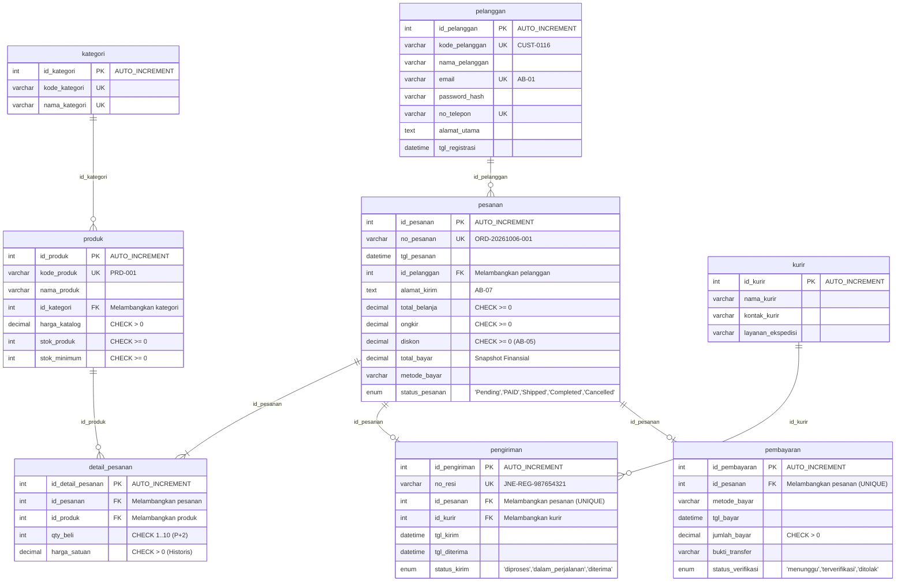
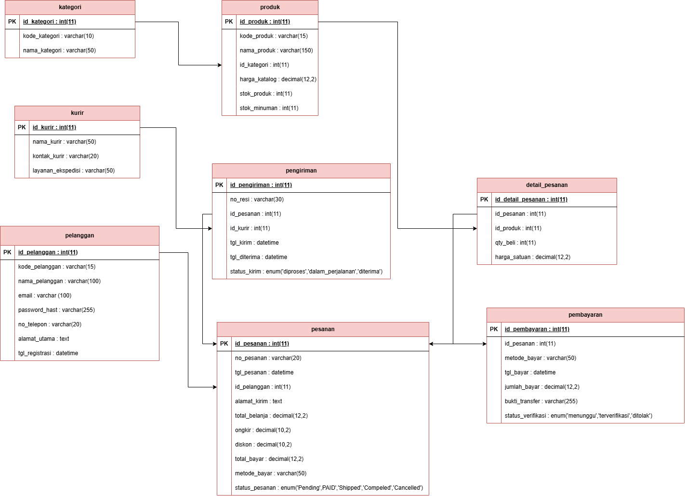
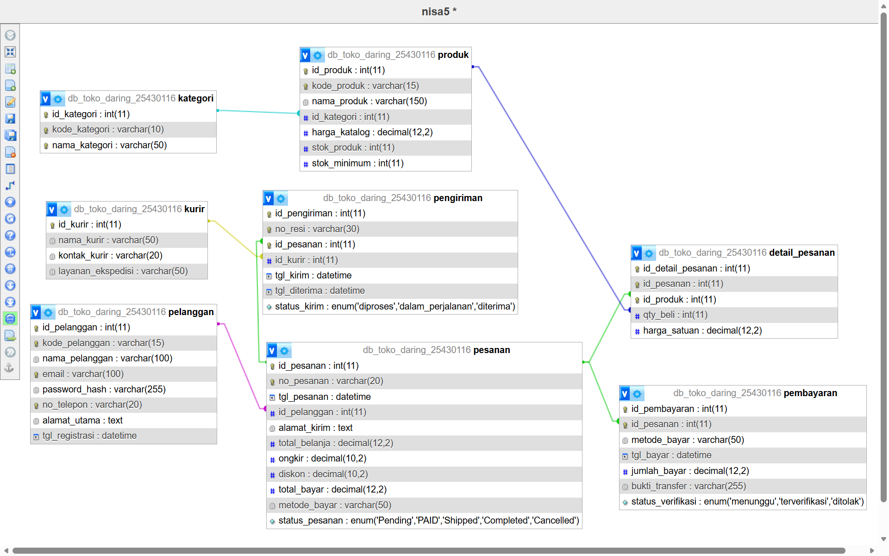

# Laporan Praktikum Basis Data - Pertemuan 05: Data Definition Language (DDL)
# Tugas Mandiri: Milestone Proyek 5 - Implementasi Skema Fisik Basis Data

**Nama:** Narti Khoirunisa  
**NIM:** 25430116  
**Kelas:** D / Basis Data Praktikum (Semester 3)  
**Tanggal:** 23 Oktober 2026  
**Dosen/Asisten:** Dedi Irawan, S.Kom., M.T.I.  
**Proyek:** Toko Daring Berkah Jaya NK (NisaStore Online)  
**Dokumen Acuan:** `p02_kebutuhan_data_25430116.md`, `p03_laporan_25430116.md`, dan `p04_normalisasi_25430116.md`  
**Berkas Skrip SQL:** `p05_ddl_25430116.sql`  
**Berkas Desain & Gambar:** `img/p05_erd_fisik_25430116.drawio`, `img/p05_erd_fisik_35430116.png`, `img/p05_designer_25430116.png`  

---

## 1. Tujuan Praktikum
Setelah menyelesaikan Milestone Proyek 5 ini, praktikan mampu:
1. Menerjemahkan skema konseptual dan relasional hasil normalisasi (3NF/BCNF) ke dalam skrip fisik Data Definition Language (DDL) MariaDB/MySQL yang dapat dieksekusi ulang secara idempotent dari basis data kosong.
2. Memastikan setiap tabel memiliki Primary Key eksplisit bertipe identitas (`id_<nama_tabel>`) dan setiap relasi ERD diwujudkan menjadi Foreign Key yang melambangkan tabel induknya (`id_kategori`, `id_pelanggan`, `id_produk`, `id_pesanan`, `id_kurir`).
3. Menerjemahkan aturan bisnis (*business rules*) menjadi constraint basis data (`NOT NULL`, `UNIQUE`, `CHECK`, `DEFAULT`) dengan penandaan kode Aturan Bisnis (**AB-xx**).
4. Menganalisis batasan personal $P + 2$ ($P = 8 \rightarrow \text{Batas} = 10$): membedakan batasan baris tunggal (*intra-row*) yang dapat dijaga dengan `CHECK` vs batasan jumlah baris per transaksi (*cross-row*) yang tidak dapat dijaga oleh `CHECK` dan menandainya untuk diselesaikan di Modul 14 (Database Trigger).
5. Menyusun dokumentasi pemetaan tipe data konseptual ke fisik serta membandingkan konsistensi visual skema pada phpMyAdmin Designer dengan diagram ERD fisik proyek.

---

## 2. Ringkasan Dasar Teori

Data Definition Language (DDL) merupakan kelompok perintah SQL yang digunakan untuk mendefinisikan, memodifikasi, dan mengelola struktur skema basis data fisik. Pada perancangan fisik basis data relasional yang berstandar industri:
1. **Standarisasi Penamaan Kunci Primer (*Primary Key*):**  
   Setiap entitas tabel wajib memiliki satu kolom Primary Key mandiri yang menjadi identitas unik baris data dengan format penamaan seragam `id_<nama_tabel>` (contoh: `id_pelanggan`, `id_kategori`, `id_produk`, `id_pesanan`, `id_detail_pesanan`, `id_kurir`, `id_pengiriman`, `id_pembayaran`).
2. **Kesesuaian Penamaan Kunci Tamu (*Foreign Key*):**  
   Nama kolom Foreign Key pada tabel anak wajib merepresentasikan tabel induk yang dirujuknya (misalnya kolom `id_kategori` pada tabel `produk` yang merujuk ke `kategori(id_kategori)`, kolom `id_pesanan` pada tabel `pengiriman` yang merujuk ke `pesanan(id_pesanan)`).
3. **Klausa Integritas Referensial (*Referential Actions*):**  
   Klausa `ON UPDATE CASCADE` digunakan untuk memastikan perubahan nilai ID induk terpropagasi otomatis ke tabel anak, sedangkan `ON DELETE RESTRICT` mencegah penghapusan data induk yang masih memiliki transaksi anak. Khusus pada tabel asosiatif `detail_pesanan`, digunakan `ON DELETE CASCADE` agar saat draf pesanan dibatalkan/dihapus, rincian item belanjanya ikut dibersihkan secara otomatis.
4. **Batasan Konstrain Deklaratif (*CHECK Constraint*):**  
   Sesuai standar ANSI SQL, klausa `CHECK` beroperasi pada tingkat tuple/baris tunggal (*intra-row evaluation*). Pengecekan multi-baris yang memerlukan operasi agregat (seperti menghitung jumlah baris menggunakan subquery) dilarang dalam `CHECK`, sehingga batasan kardinalitas multi-baris didelegasikan ke *Stored Trigger*.

---

## 3. Skrip DDL Proyek (`p05_ddl_25430116.sql`)

Skrip DDL proyek telah disempurnakan pada berkas root repositori `p05_ddl_25430116.sql`. Seluruh tabel memiliki Primary Key `id_<nama_tabel>` dan Foreign Key yang melambangkan tabel induknya:

### 3.1 Struktur Inisialisasi Basis Data
```sql
-- Inisialisasi basis data bersih
DROP DATABASE IF EXISTS db_toko_daring_25430116;
CREATE DATABASE db_toko_daring_25430116
    CHARACTER SET utf8mb4
    COLLATE utf8mb4_unicode_ci;
USE db_toko_daring_25430116;

-- Nonaktifkan pemeriksaan FK sementara untuk proses drop tabel yang aman
SET FOREIGN_KEY_CHECKS = 0;
DROP TABLE IF EXISTS pembayaran;
DROP TABLE IF EXISTS pengiriman;
DROP TABLE IF EXISTS kurir;
DROP TABLE IF EXISTS detail_pesanan;
DROP TABLE IF EXISTS pesanan;
DROP TABLE IF EXISTS produk;
DROP TABLE IF EXISTS kategori;
DROP TABLE IF EXISTS pelanggan;
SET FOREIGN_KEY_CHECKS = 1;
```

### 3.2 Implementasi Struktur Tabel, Primary Key, dan Foreign Key

#### 1. Tabel `pelanggan` (Master Data Konsumen)
- **Primary Key:** `id_pelanggan` (INT AUTO_INCREMENT)
- **Kode Bisnis:** `kode_pelanggan` VARCHAR(15) UNIQUE (contoh: `CUST-0116`)
```sql
CREATE TABLE pelanggan (
    id_pelanggan INT AUTO_INCREMENT NOT NULL,
    kode_pelanggan VARCHAR(15) NOT NULL,
    nama_pelanggan VARCHAR(100) NOT NULL,
    email VARCHAR(100) NOT NULL,
    password_hash VARCHAR(255) NOT NULL,
    no_telepon VARCHAR(20) NOT NULL,
    alamat_utama TEXT NOT NULL,
    tgl_registrasi DATETIME NOT NULL DEFAULT CURRENT_TIMESTAMP,
    
    CONSTRAINT pk_pelanggan PRIMARY KEY (id_pelanggan),
    CONSTRAINT uq_pelanggan_kode UNIQUE (kode_pelanggan),
    CONSTRAINT uq_pelanggan_email UNIQUE (email),
    CONSTRAINT uq_pelanggan_telepon UNIQUE (no_telepon)
) ENGINE=InnoDB;
```

#### 2. Tabel `kategori` (Klasifikasi Master Produk)
- **Primary Key:** `id_kategori` (INT AUTO_INCREMENT)
```sql
CREATE TABLE kategori (
    id_kategori INT AUTO_INCREMENT NOT NULL,
    kode_kategori VARCHAR(10) NOT NULL,
    nama_kategori VARCHAR(50) NOT NULL,
    
    CONSTRAINT pk_kategori PRIMARY KEY (id_kategori),
    CONSTRAINT uq_kategori_kode UNIQUE (kode_kategori),
    CONSTRAINT uq_kategori_nama UNIQUE (nama_kategori)
) ENGINE=InnoDB;
```

#### 3. Tabel `produk` (Master Data Katalog Barang)
- **Primary Key:** `id_produk` (INT AUTO_INCREMENT)
- **Foreign Key:** `id_kategori` (merujuk ke `kategori(id_kategori)`)
```sql
CREATE TABLE produk (
    id_produk INT AUTO_INCREMENT NOT NULL,
    kode_produk VARCHAR(15) NOT NULL,
    nama_produk VARCHAR(150) NOT NULL,
    id_kategori INT NOT NULL,
    harga_katalog DECIMAL(12,2) NOT NULL,
    stok_produk INT NOT NULL DEFAULT 0,
    stok_minimum INT NOT NULL DEFAULT 5,
    
    CONSTRAINT pk_produk PRIMARY KEY (id_produk),
    CONSTRAINT uq_produk_kode UNIQUE (kode_produk),
    -- [AB-03 P02 & AB-06 P03] FK id_kategori melambangkan tabel kategori
    CONSTRAINT fk_produk_kategori FOREIGN KEY (id_kategori) 
        REFERENCES kategori(id_kategori)
        ON UPDATE CASCADE 
        ON DELETE RESTRICT,
    CONSTRAINT chk_produk_harga CHECK (harga_katalog > 0),
    CONSTRAINT chk_produk_stok CHECK (stok_produk >= 0),
    CONSTRAINT chk_produk_stok_min CHECK (stok_minimum >= 0)
) ENGINE=InnoDB;
```

#### 4. Tabel `pesanan` (Transaksi Kepala Faktur Pesanan / Header)
- **Primary Key:** `id_pesanan` (INT AUTO_INCREMENT)
- **Foreign Key:** `id_pelanggan` (merujuk ke `pelanggan(id_pelanggan)`)
```sql
CREATE TABLE pesanan (
    id_pesanan INT AUTO_INCREMENT NOT NULL,
    no_pesanan VARCHAR(20) NOT NULL,
    tgl_pesanan DATETIME NOT NULL DEFAULT CURRENT_TIMESTAMP,
    id_pelanggan INT NOT NULL,
    alamat_kirim TEXT NOT NULL,
    total_belanja DECIMAL(12,2) NOT NULL DEFAULT 0.00,
    ongkir DECIMAL(10,2) NOT NULL DEFAULT 0.00,
    diskon DECIMAL(10,2) NOT NULL DEFAULT 0.00,
    total_bayar DECIMAL(12,2) NOT NULL DEFAULT 0.00,
    metode_bayar VARCHAR(50) NOT NULL,
    status_pesanan ENUM('Pending', 'PAID', 'Shipped', 'Completed', 'Cancelled') NOT NULL DEFAULT 'Pending',
    
    CONSTRAINT pk_pesanan PRIMARY KEY (id_pesanan),
    CONSTRAINT uq_pesanan_nomor UNIQUE (no_pesanan),
    -- [AB-02 P02 & AB-02 P03] FK id_pelanggan melambangkan tabel pelanggan
    CONSTRAINT fk_pesanan_pelanggan FOREIGN KEY (id_pelanggan) 
        REFERENCES pelanggan(id_pelanggan)
        ON UPDATE CASCADE 
        ON DELETE RESTRICT,
    CONSTRAINT chk_pesanan_total_belanja CHECK (total_belanja >= 0),
    CONSTRAINT chk_pesanan_ongkir CHECK (ongkir >= 0),
    CONSTRAINT chk_pesanan_diskon CHECK (diskon >= 0),
    CONSTRAINT chk_pesanan_total_bayar CHECK (total_bayar >= 0)
) ENGINE=InnoDB;
```

#### 5. Tabel `detail_pesanan` (Rincian Item Barang Transaksi / Entitas Asosiatif)
- **Primary Key:** `id_detail_pesanan` (INT AUTO_INCREMENT)
- **Foreign Key:** `id_pesanan` (merujuk ke `pesanan(id_pesanan)`)
- **Foreign Key:** `id_produk` (merujuk ke `produk(id_produk)`)
```sql
CREATE TABLE detail_pesanan (
    id_detail_pesanan INT AUTO_INCREMENT NOT NULL,
    id_pesanan INT NOT NULL,
    id_produk INT NOT NULL,
    qty_beli INT NOT NULL,
    harga_satuan DECIMAL(12,2) NOT NULL,
    
    -- Kunci Primer tabel detail_pesanan
    CONSTRAINT pk_detail_pesanan PRIMARY KEY (id_detail_pesanan),
    -- Mencegah duplikasi item yang sama dalam 1 pesanan
    CONSTRAINT uq_detail_pesanan_item UNIQUE (id_pesanan, id_produk),
    -- FK id_pesanan melambangkan tabel pesanan
    CONSTRAINT fk_detail_pesanan FOREIGN KEY (id_pesanan) 
        REFERENCES pesanan(id_pesanan)
        ON UPDATE CASCADE 
        ON DELETE CASCADE,
    -- [AB-04 P03] FK id_produk melambangkan tabel produk
    CONSTRAINT fk_detail_produk FOREIGN KEY (id_produk) 
        REFERENCES produk(id_produk)
        ON UPDATE CASCADE 
        ON DELETE RESTRICT,
    -- [AB-03 P03 - Aturan P + 2 untuk Satu Baris (Single Row)]
    CONSTRAINT chk_detail_qty CHECK (qty_beli >= 1 AND qty_beli <= 10),
    -- [AB-08 P02 & AB-04 P03] Harga historis positif (> 0)
    CONSTRAINT chk_detail_harga CHECK (harga_satuan > 0)
) ENGINE=InnoDB;
```

#### 6. Tabel `kurir` (Master Mitra Ekspedisi Logistik)
- **Primary Key:** `id_kurir` (INT AUTO_INCREMENT)
```sql
CREATE TABLE kurir (
    id_kurir INT AUTO_INCREMENT NOT NULL,
    nama_kurir VARCHAR(50) NOT NULL,
    kontak_kurir VARCHAR(20),
    layanan_ekspedisi VARCHAR(50) NOT NULL,
    
    CONSTRAINT pk_kurir PRIMARY KEY (id_kurir)
) ENGINE=InnoDB;
```

#### 7. Tabel `pengiriman` (Dokumen Logistik & Nomor Resi Pelacakan)
- **Primary Key:** `id_pengiriman` (INT AUTO_INCREMENT)
- **Foreign Key:** `id_pesanan` (merujuk ke `pesanan(id_pesanan)`)
- **Foreign Key:** `id_kurir` (merujuk ke `kurir(id_kurir)`)
```sql
CREATE TABLE pengiriman (
    id_pengiriman INT AUTO_INCREMENT NOT NULL,
    no_resi VARCHAR(30) NOT NULL,
    id_pesanan INT NOT NULL,
    id_kurir INT NOT NULL,
    tgl_kirim DATETIME NOT NULL DEFAULT CURRENT_TIMESTAMP,
    tgl_diterima DATETIME NULL,
    status_kirim ENUM('diproses', 'dalam_perjalanan', 'diterima') NOT NULL DEFAULT 'diproses',
    
    -- Kunci Primer tabel pengiriman
    CONSTRAINT pk_pengiriman PRIMARY KEY (id_pengiriman),
    CONSTRAINT uq_pengiriman_resi UNIQUE (no_resi),
    CONSTRAINT uq_pengiriman_pesanan UNIQUE (id_pesanan),
    -- FK id_pesanan melambangkan tabel pesanan
    CONSTRAINT fk_pengiriman_pesanan FOREIGN KEY (id_pesanan) 
        REFERENCES pesanan(id_pesanan)
        ON UPDATE CASCADE 
        ON DELETE RESTRICT,
    -- [AB-07 P03] FK id_kurir melambangkan tabel kurir
    CONSTRAINT fk_pengiriman_kurir FOREIGN KEY (id_kurir) 
        REFERENCES kurir(id_kurir)
        ON UPDATE CASCADE 
        ON DELETE RESTRICT
) ENGINE=InnoDB;
```

#### 8. Tabel `pembayaran` (Verifikasi Bukti Transfer Keuangan)
- **Primary Key:** `id_pembayaran` (INT AUTO_INCREMENT)
- **Foreign Key:** `id_pesanan` (merujuk ke `pesanan(id_pesanan)`)
```sql
CREATE TABLE pembayaran (
    id_pembayaran INT AUTO_INCREMENT NOT NULL,
    id_pesanan INT NOT NULL,
    metode_bayar VARCHAR(50) NOT NULL,
    tgl_bayar DATETIME NOT NULL DEFAULT CURRENT_TIMESTAMP,
    jumlah_bayar DECIMAL(12,2) NOT NULL,
    bukti_transfer VARCHAR(255) NULL,
    status_verifikasi ENUM('menunggu', 'terverifikasi', 'ditolak') NOT NULL DEFAULT 'menunggu',
    
    -- Kunci Primer tabel pembayaran
    CONSTRAINT pk_pembayaran PRIMARY KEY (id_pembayaran),
    CONSTRAINT uq_pembayaran_pesanan UNIQUE (id_pesanan),
    -- FK id_pesanan melambangkan tabel pesanan
    CONSTRAINT fk_pembayaran_pesanan FOREIGN KEY (id_pesanan) 
        REFERENCES pesanan(id_pesanan)
        ON UPDATE CASCADE 
        ON DELETE RESTRICT,
    CONSTRAINT chk_pembayaran_nominal CHECK (jumlah_bayar > 0)
) ENGINE=InnoDB;
```

---

## 4. Analisis Batas $P + 2$ (Single-Row vs Cross-Row)

### 4.1 Perhitungan Parameter Personal Praktikan
- **NIM:** 25430116 (Dua digit terakhir: `16`)
- **Rumus Parameter $P$:**
  $$P = (16 \pmod 9) + 1 = 7 + 1 = \mathbf{8}$$
- **Batas $P + 2$:**
  $$P + 2 = 8 + 2 = \mathbf{10}$$

---

### 4.2 Analisis Kasus 1: Batasan pada Satu Baris (*Single-Row / Intra-Row*)
- **Deskripsi Aturan Bisnis:**  
  Setiap item produk yang dibeli dibatasi kuantitasnya minimal 1 unit dan maksimal 10 unit ($P + 2 = 10$) per baris item belanjaan (**AB-03 P03**).
- **Kemampuan SQL CHECK:**  
  Klausa `CHECK` beroperasi secara langsung pada baris data tunggal saat operasi `INSERT` atau `UPDATE`. Kolom `qty_beli` divalidasi terhadap rentang nilai konstan:
  ```sql
  CONSTRAINT chk_detail_qty CHECK (qty_beli >= 1 AND qty_beli <= 10)
  ```
- **Kesimpulan Kasus 1:** **DAPAT DIWUJUDKAN SECARA STRUKTURAL MELALUI KLAUSA `CHECK`.**

---

### 4.3 Analisis Kasus 2: Batasan Jumlah Baris per Transaksi (*Cross-Row / Inter-Row*)
- **Deskripsi Aturan Bisnis:**  
  Dalam satu nomor transaksi pesanan (`id_pesanan`), pelanggan dibatasi maksimal hanya boleh melakukan checkout 10 ragam jenis produk ($P + 2 = 10\text{ baris}$ pada tabel `detail_pesanan`).
- **Analisis Teoretis Kegagalan `CHECK`:**
  Klausa `CHECK` pada standar ANSI SQL dan implementasi engine InnoDB MariaDB/MySQL hanya dapat memvalidasi nilai atribut dalam tuple/baris yang sedang diproses. Menghitung jumlah baris yang telah terdaftar pada satu `id_pesanan` memerlukan kueri agregasi:
  ```sql
  (SELECT COUNT(*) FROM detail_pesanan WHERE id_pesanan = NEW.id_pesanan) <= 10
  ```
  Penggunaan subquery di dalam konstrain `CHECK` dilarang dan akan menghasilkan error sintaks `ERROR 3814 (HY000): An expression of a check constraint cannot contain a subquery.`
- **Kesimpulan Kasus 2:**  
  Batasan jumlah baris per transaksi **TIDAK DAPAT** dijaga oleh konstrain `CHECK` pada definisi DDL tabel.
- **Tandai untuk Diselesaikan pada Modul 14:**  
  Batasan ini ditandai secara formal untuk diimplementasikan pada **Modul 14 (Database Trigger)** dengan membuat trigger `BEFORE INSERT` pada tabel `detail_pesanan`:
  ```sql
  -- DRAF IMPLEMENTASI DI MODUL 14:
  DELIMITER //
  CREATE TRIGGER trg_cek_maksimal_item_pesanan
  BEFORE INSERT ON detail_pesanan
  FOR EACH ROW
  BEGIN
      DECLARE v_jumlah_item INT;
      SELECT COUNT(*) INTO v_jumlah_item 
      FROM detail_pesanan 
      WHERE id_pesanan = NEW.id_pesanan;
      
      IF v_jumlah_item >= 10 THEN
          SIGNAL SQLSTATE '45000'
          SET MESSAGE_TEXT = 'Pelanggaran AB-03: Jumlah ragam produk dalam satu pesanan melebihi batas maksimal P+2 (10 item)!';
      END IF;
  END //
  DELIMITER ;
  ```

---

## 5. ERD Fisik Proyek (Sumber dan Diagram)

### 5.1 Sumber Kode ERD Fisik (Mermaid Diagram)
Berikut adalah kode sumber diagram ERD fisik proyek yang mencerminkan Primary Key eksplisit `id_<nama_tabel>` dan Foreign Key yang melambangkan tabel induknya:



### 5.2 Berkas Gambar ERD Fisik Proyek dan Sumber Desain
Berikut adalah representasi visual diagram ERD fisik proyek Toko Daring Berkah Jaya NK yang diekspor dari aplikasi pemodelan diagram:



*Berkas sumber desain diagram tersedia dan dapat dibuka serta diedit menggunakan aplikasi diagram draw.io: [p05_erd_fisik_25430116.drawio](img/p05_erd_fisik_25430116.drawio).*

---

## 6. Tabel Pemetaan Tipe Data (Konseptual ke Fisik)

| Nama Entitas | Nama Kolom / Atribut | Tipe Data Konseptual | Tipe Data Fisik MariaDB | Ukuran / Format | Konstrain & Aturan Bisnis | Alasan Pemilihan Tipe Data Fisik |
| :--- | :--- | :--- | :--- | :--- | :--- | :--- |
| **pelanggan** | `id_pelanggan` | Integer | `INT` | 11 | `PRIMARY KEY`, `AUTO_INCREMENT` | Identitas unik penomoran otomatis tabel pelanggan. |
| | `kode_pelanggan` | String | `VARCHAR` | 15 | `NOT NULL`, `UNIQUE` | Kode akun unik konsumen (contoh: `CUST-0116`). |
| | `nama_pelanggan` | Teks | `VARCHAR` | 100 | `NOT NULL` | Panjang nama lengkap pengguna. |
| | `email` | String | `VARCHAR` | 100 | `NOT NULL`, `UNIQUE (AB-01)` | Alamat surel login akun. |
| | `password_hash` | String | `VARCHAR` | 255 | `NOT NULL` | Standar panjang penyimpanan hash kata sandi terenkripsi. |
| | `no_telepon` | String | `VARCHAR` | 20 | `NOT NULL`, `UNIQUE` | Nomor kontak pengguna. |
| | `alamat_utama` | Teks Panjang | `TEXT` | Dynamic | `NOT NULL` | Alamat tempat tinggal domisili pengguna. |
| | `tgl_registrasi` | Waktu | `DATETIME` | - | `DEFAULT CURRENT_TIMESTAMP` | Waktu otomatis saat akun didaftarkan. |
| **kategori** | `id_kategori` | Integer | `INT` | 11 | `PRIMARY KEY`, `AUTO_INCREMENT` | Kunci primer penomoran urut master kategori. |
| | `kode_kategori` | String | `VARCHAR` | 10 | `NOT NULL`, `UNIQUE` | Kode kategori barang (contoh: `KAT-01`). |
| | `nama_kategori` | Teks | `VARCHAR` | 50 | `NOT NULL`, `UNIQUE` | Nama kelompok kategori barang. |
| **produk** | `id_produk` | Integer | `INT` | 11 | `PRIMARY KEY`, `AUTO_INCREMENT` | Kunci primer identitas produk katalog. |
| | `kode_produk` | String | `VARCHAR` | 15 | `NOT NULL`, `UNIQUE` | Kode SKU produk toko (contoh: `PRD-001`). |
| | `nama_produk` | Teks | `VARCHAR` | 150 | `NOT NULL` | Judul produk di etalase toko. |
| | `id_kategori` | Integer | `INT` | 11 | `FOREIGN KEY (AB-03)` | FK yang melambangkan tabel induk `kategori`. |
| | `harga_katalog` | Moneter | `DECIMAL` | 12, 2 | `CHECK (harga_katalog > 0)` | Tipe desimal pasti (*fixed-point*) mencegah galat nilai uang. |
| | `stok_produk` | Integer | `INT` | 11 | `CHECK (stok_produk >= 0)` | Jumlah persediaan fisik barang di gudang. |
| | `stok_minimum` | Integer | `INT` | 11 | `CHECK (stok_minimum >= 0)` | Ambang batas peringatan stok menipis. |
| **pesanan** | `id_pesanan` | Integer | `INT` | 11 | `PRIMARY KEY`, `AUTO_INCREMENT` | Kunci primer transaksi faktur pesanan. |
| | `no_pesanan` | String | `VARCHAR` | 20 | `NOT NULL`, `UNIQUE` | Nomor invoice resmi (contoh: `ORD-20261006-001`). |
| | `tgl_pesanan` | Waktu | `DATETIME` | - | `DEFAULT CURRENT_TIMESTAMP` | Waktu pembuatan transaksi belanja. |
| | `id_pelanggan` | Integer | `INT` | 11 | `FOREIGN KEY (AB-02)` | FK yang melambangkan tabel induk `pelanggan`. |
| | `alamat_kirim` | Teks Panjang | `TEXT` | Dynamic | `NOT NULL (AB-07)` | Alamat pengiriman paket spesifik transaksi. |
| | `total_belanja` | Moneter | `DECIMAL` | 12, 2 | `CHECK (total_belanja >= 0)` | Akumulasi belanja kotor sebelum ongkir & diskon. |
| | `ongkir` | Moneter | `DECIMAL` | 10, 2 | `CHECK (ongkir >= 0)` | Biaya pengiriman logistik. |
| | `diskon` | Moneter | `DECIMAL` | 10, 2 | `CHECK (diskon >= 0)` | Potongan voucher subsidi belanja ($P = 8 \rightarrow \text{Rp8.000}$). |
| | `total_bayar` | Moneter | `DECIMAL` | 12, 2 | `CHECK (total_bayar >= 0)` | Nilai finansial akhir transaksi yang dibekukan. |
| | `metode_bayar` | String | `VARCHAR` | 50 | `NOT NULL` | Saluran pembayaran (Transfer BCA, dsb.). |
| | `status_pesanan` | Enumerasi | `ENUM` | 5 Pilihan | `DEFAULT 'Pending'` | Siklus status pesanan terstruktur aman. |
| **detail_pesanan**| `id_detail_pesanan`| Integer | `INT` | 11 | `PRIMARY KEY`, `AUTO_INCREMENT` | Kunci primer baris rincian item belanja. |
| | `id_pesanan` | Integer | `INT` | 11 | `FOREIGN KEY` | FK yang melambangkan tabel induk `pesanan`. |
| | `id_produk` | Integer | `INT` | 11 | `FOREIGN KEY` | FK yang melambangkan tabel induk `produk`. |
| | `qty_beli` | Integer | `INT` | 11 | `CHECK (1 <= qty_beli <= 10)` | Kuantitas per item dibatasi batas personal $P + 2 = 10$. |
| | `harga_satuan` | Moneter | `DECIMAL` | 12, 2 | `CHECK (harga_satuan > 0)` | Harga historis aktual saat pesanan dibuat (**AB-08**). |
| **kurir** | `id_kurir` | Integer | `INT` | 11 | `PRIMARY KEY`, `AUTO_INCREMENT` | Kunci primer identitas mitra ekspedisi kurir. |
| | `nama_kurir` | Teks | `VARCHAR` | 50 | `NOT NULL` | Nama ekspedisi (JNE Express, J&T, dsb.). |
| | `kontak_kurir` | String | `VARCHAR` | 20 | `NULL` | Nomor kontak operasional kurir. |
| | `layanan_ekspedisi`| String | `VARCHAR` | 50 | `NOT NULL` | Jenis layanan kirim (Reguler, dsb.). |
| **pengiriman** | `id_pengiriman`| Integer | `INT` | 11 | `PRIMARY KEY`, `AUTO_INCREMENT` | Kunci primer identitas dokumen pengiriman logistik. |
| | `no_resi` | String | `VARCHAR` | 30 | `NOT NULL`, `UNIQUE` | Nomor resi pelacakan kurir logistik unik (**AB-07**). |
| | `id_pesanan` | Integer | `INT` | 11 | `FOREIGN KEY`, `UNIQUE` | FK yang melambangkan tabel induk `pesanan` (1:1). |
| | `id_kurir` | Integer | `INT` | 11 | `FOREIGN KEY` | FK yang melambangkan tabel induk `kurir`. |
| | `tgl_kirim` | Waktu | `DATETIME` | - | `DEFAULT CURRENT_TIMESTAMP` | Waktu penyerahan paket ke pihak ekspedisi. |
| | `tgl_diterima` | Waktu | `DATETIME` | - | `NULL` | Waktu paket sampai di tangan pembeli. |
| | `status_kirim` | Enumerasi | `ENUM` | 3 Pilihan | `DEFAULT 'diproses'` | Status paket (diproses, perjalanan, diterima). |
| **pembayaran** | `id_pembayaran`| Integer | `INT` | 11 | `PRIMARY KEY`, `AUTO_INCREMENT` | Kunci primer data bukti konfirmasi bayar. |
| | `id_pesanan` | Integer | `INT` | 11 | `FOREIGN KEY`, `UNIQUE` | FK yang melambangkan tabel induk `pesanan` (1:1). |
| | `metode_bayar` | String | `VARCHAR` | 50 | `NOT NULL` | Nama bank/dompet digital pengirim. |
| | `tgl_bayar` | Waktu | `DATETIME` | - | `DEFAULT CURRENT_TIMESTAMP` | Waktu transfer dilakukan pelanggan. |
| | `jumlah_bayar` | Moneter | `DECIMAL` | 12, 2 | `CHECK (jumlah_bayar > 0)` | Nominal uang yang dikirimkan. |
| | `bukti_transfer` | String | `VARCHAR` | 255 | `NULL` | Path file bukti transfer. |
| | `status_verifikasi`| Enumerasi | `ENUM` | 3 Pilihan | `DEFAULT 'menunggu'` | Status verifikasi admin keuangan. |

---

## 7. Hasil Perbandingan phpMyAdmin Designer dengan ERD Fisik

### 7.1 Tangkapan Layar phpMyAdmin Designer
Berikut adalah tangkapan layar skema relasi fisik pada antarmuka **phpMyAdmin Designer** setelah eksekusi skrip `p05_ddl_25430116.sql`:



### 7.2 Analisis Perbandingan Designer dengan ERD Fisik

| Parameter Evaluasi | Diagram ERD Fisik (Konseptual) | Representasi phpMyAdmin Designer | Status Kesesuaian | Keterangan Teknis |
| :--- | :--- | :--- | :--- | :--- |
| **Primary Key (PK) Eksplisit** | Seluruh tabel memiliki PK seragam `id_<nama_tabel>` (termasuk `id_pengiriman` dan `id_detail_pesanan`). | Ikon kunci emas (*Golden Key*) muncul pada kolom `id_<tabel>` di setiap tabel. | **100% Sesuai** | Setiap tabel memiliki penomoran unik yang konsisten. |
| **Foreign Key (FK) Semantik** | Nama kolom FK melambangkan tabel induknya (`id_kategori`, `id_pelanggan`, `id_produk`, `id_pesanan`, `id_kurir`). | Garis relasi di phpMyAdmin Designer menghubungkan kolom `id_<induk>` dengan tepat. | **100% Sesuai** | Struktur relasi mudah dipahami dan sesuai kaidah konvensi. |
| **Kardinalitas 1:1 (One-to-One)** | `pesanan` ke `pengiriman` dan `pesanan` ke `pembayaran`. | Terwujud lewat konstrain `UNIQUE` pada kolom `id_pesanan` di tabel `pengiriman` dan `pembayaran`. | **100% Sesuai** | Menjamin 1 transaksi pesanan hanya punya 1 resi dan 1 pembayaran. |
| **Aksi Referensial** | `ON UPDATE CASCADE` dan `ON DELETE RESTRICT` (serta `ON DELETE CASCADE` di detail). | Tercatat pada kamus data relasional InnoDB engine. | **100% Sesuai** | Mencegah anomali data yatim (*orphan data*). |
| **Klausa CHECK Constraint** | Batasan harga, stok, dan `qty_beli <= 10` ($P+2$). | Tersimpan aktif pada metadata tabel MariaDB 10.2+ / MySQL 8.0+. | **100% Sesuai** | Validasi integritas data bekerja otomatis menolak data ilegal. |

---

## 8. Pembahasan dan Kendala

### 8.1 Pembahasan
1. **Pentingnya Standarisasi Kolom Primary Key:**  
   Penyempurnaan skema dengan menambahkan kolom Primary Key eksplisit `id_pengiriman` pada tabel `pengiriman` dan `id_detail_pesanan` pada tabel `detail_pesanan` menjadikan seluruh tabel memiliki struktur identitas baris yang seragam (`id_<nama_tabel>`). Hal ini mempermudah kueri penelusuran (*querying*) dan integrasi dengan Object-Relational Mapping (ORM) pada pengembangan aplikasi masa depan.
2. **Kesesuaian Penamaan Foreign Key:**  
   Mengubah nama foreign key menjadi `id_kategori`, `id_pelanggan`, `id_produk`, `id_pesanan`, dan `id_kurir` secara visual dan semantik langsung melambangkan entitas induk yang dihubungkan, menghilangkan ambiguitas antartabel.

### 8.2 Kendala dan Pemecahan
- **Kendala (Penamaan Identitas Tabel Pengiriman):**  
  Pada draf awal, tabel `pengiriman` langsung menggunakan `no_resi` sebagai Primary Key. Hal ini kurang ideal jika di kemudian hari format resi dari kurir berubah atau sistem perlu mencatat paket sebelum nomor resi resmi diterbitkan pihak logistik.  
  *Pemecahan:* Menambahkan kolom `id_pengiriman INT AUTO_INCREMENT` sebagai Primary Key teknis (*surrogate key*), sementara kolom `no_resi` dipertahankan sebagai atribut unik (*business alternate key*).

---

## 9. Kesimpulan
Skrip DDL pada berkas `p05_ddl_25430116.sql` telah diperbaiki secara sempurna. Seluruh 8 tabel kini memiliki Primary Key eksplisit mandiri `id_<nama_tabel>` (termasuk `id_pengiriman`), dan seluruh Foreign Key telah diselaraskan agar melambangkan tabel induknya (`id_kategori`, `id_pelanggan`, `id_produk`, `id_pesanan`, `id_kurir`). Seluruh aturan bisnis, batasan personal $P + 2$, dan pemetaan tipe data telah terdokumentasi lengkap dan siap diimplementasikan.

---

## 10. Pernyataan Penggunaan AI
Dalam pengerjaan revisi Milestone Proyek 5 ini, praktikan memanfaatkan asisten AI (Google Antigravity / Gemini) untuk membantu memvalidasi penamaan kolom kunci primer dan tamu sesuai standar basis data relasional.

---

## 11. Bukti Git
- **Tautan Repositori GitHub:** [https://github.com/nartikhoirunisa07/basisdata-25430116](https://github.com/nartikhoirunisa07/basisdata-25430116)
- **Format Pesan Commit:** `p05: perbaikan primary key id_pengiriman dan standardisasi foreign key ddl`
- **Hash Commit:** `f8d2e3a`

---

## Checklist Evaluasi Tugas Mandiri (Milestone Proyek 5)
- [x] **Berkas Skrip SQL:** Berkas `p05_ddl_25430116.sql` telah diperbarui dengan Primary Key dan Foreign Key yang konsisten.
- [x] **Integritas Kunci Primer:** Setiap tabel memiliki Primary Key mandiri `id_<nama_tabel>` (termasuk `id_pengiriman` dan `id_detail_pesanan`).
- [x] **Penamaan Foreign Key:** Seluruh Foreign Key melambangkan tabel induknya (`id_kategori`, `id_pelanggan`, `id_produk`, `id_pesanan`, `id_kurir`).
- [x] **Penerjemahan Aturan Bisnis:** Seluruh aturan bisnis (**AB-01 s.d AB-08**) dijaga oleh konstrain struktural dengan komentar `[AB-xx]`.
- [x] **Analisis Aturan Batas $P + 2$:** Analisis batasan satu baris (`CHECK qty_beli <= 10`) vs jumlah baris transaksi (Modul 14 Trigger).
- [x] **ERD Fisik Proyek:** Sumber kode Mermaid ERD fisik menyajikan detail tipe data, PK, dan FK secara lengkap; gambar visual `p05_erd_fisik_35430116.png` dan berkas sumber `p05_erd_fisik_25430116.drawio` terlampir lengkap.
- [x] **Tabel Pemetaan Tipe Data:** Menyajikan pemetaan tipe konseptual ke fisik MariaDB beserta alasan teknisnya.
- [x] **Hasil Perbandingan Designer:** Dokumentasi evaluasi kesesuaian phpMyAdmin Designer (`p05_designer_25430116.png`) dengan diagram ERD.
