# Laporan Praktikum Basis Data - Pertemuan 07: Menjawab Pertanyaan dengan SELECT dan Fungsi Skalar
# Tugas Mandiri: Milestone Proyek 7 - Kueri Satu Tabel dan Fungsi Skalar

**Nama:** Narti Khoirunisa  
**NIM:** 25430116  
**Kelas:** D / Basis Data Praktikum (Semester 3)  
**Tanggal:** 09 November 2026  
**Dosen Pengampu:** Dedi Irawan, S.Kom., M.T.I.  
**Proyek:** Toko Daring Berkah Jaya NK (NisaStore Online)  
**Basis Data Utama:** `db_toko_daring_25430116`  
**Basis Data Praktikum:** `kopma_116`  
**Parameter P:** $P = (16 \pmod 9) + 1 = 8 \rightarrow \text{Batas Transaksi Utama } 10 \times P = 80 \text{ Baris}$  
**Berkas Terkait:** `p07_kueri_kopma_25430116.sql` dan `p07_kueri_25430116.sql`  

---

## 1. Tujuan Praktikum
Setelah menyelesaikan modul dan tugas mandiri milestone proyek ini, mahasiswa mampu:
1. Menulis klausa `SELECT` dengan proyeksi kolom yang spesifik, alias kolom (*column aliasing*), serta mengeliminasi duplikasi data menggunakan `DISTINCT`.
2. Menyaring baris data transaksi secara akurat menggunakan operator pembanding (`=`, `<>`, `<`, `>`, `<=`, `>=`), operator logika (`AND`, `OR`, `NOT`), operator rentang `BETWEEN`, operator himpunan `IN`, pencarian pola teks `LIKE`, dan pengujian nilai kosong `IS NULL`.
3. Mengurutkan dan membatasi penyajian data menggunakan klausa `ORDER BY` (ASC/DESC) dan `LIMIT`.
4. Memanfaatkan fungsi-fungsi skalar bawaan MariaDB/MySQL (string, tanggal/waktu, numerik, dan kondisional) untuk memformat serta mentransformasi data mentah menjadi informasi siap pakai yang menjawab Kebutuhan Informasi (KI).
5. Menganalisis urutan evaluasi logis dari pernyataan `SELECT` serta membedakan antara galat sintaksis (*syntax error*) dengan kesalahan semantik (*logical/semantic error*).
6. Mengidentifikasi dan menandai batasan kueri satu tabel terhadap Kebutuhan Informasi yang memerlukan operasi multi-tabel (`JOIN`), pengelompokan baris (`GROUP BY`), dan fungsi agregasi (`SUM`, `COUNT`, `AVG`) untuk dituntaskan pada Modul 09 hingga 12.

---

## 2. Ringkasan Dasar Teori

### 2.1 Anatomi dan Urutan Evaluasi Logis Pernyataan SELECT
Secara sintaksis dalam bahasa SQL, pernyataan `SELECT` ditulis dengan urutan klausa:
$$\text{SELECT} \rightarrow \text{FROM} \rightarrow \text{WHERE} \rightarrow \text{GROUP BY} \rightarrow \text{HAVING} \rightarrow \text{ORDER BY} \rightarrow \text{LIMIT}$$

Namun demikian, mesin basis data (*Database Engine*) mengevaluasi klausa-klausa tersebut dengan urutan logis yang sangat berbeda:

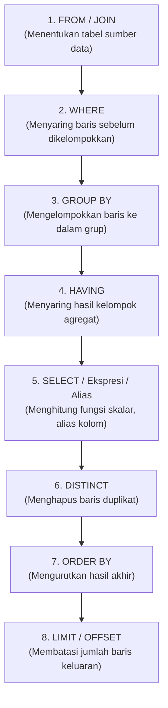

Memahami urutan evaluasi logis ini merupakan kunci utama dalam mendiagnosis berbagai galat yang umum dialami pemula:
- **Penyebab Unknown Column di WHERE:** Klausa `WHERE` dievaluasi pada tahap ke-2, sedangkan pendefinisian alias kolom baru terjadi pada tahap ke-5 (`SELECT`). Akibatnya, server menolak pemanggilan nama alias di dalam klausa `WHERE`.
- **Dukungan Alias di ORDER BY:** Sebaliknya, klausa `ORDER BY` dievaluasi pada tahap ke-7 (setelah `SELECT`), sehingga penggunaan nama alias kolom diizinkan sepenuhnya pada `ORDER BY`.

### 2.2 Galat Sintaks vs Kesalahan Semantik
- **Galat Sintaks (*Syntax Error*):** Terjadi ketika kueri melanggar tata bahasa SQL yang diakui server (misalnya salah mengetik nama kata kunci, lupa tanda koma, atau merujuk alias kolom di `WHERE`). Galat ini langsung ditolak oleh server dengan memunculkan kode galat eksplisit (contoh: `ERROR 1064` atau `ERROR 1054`).
- **Kesalahan Semantik (*Semantic/Logic Error*):** Terjadi ketika kueri berhasil dieksekusi secara legal oleh server (`Query OK, rows returned`), namun hasil datanya keliru dan tidak menjawab pertanyaan bisnis yang sesungguhnya. Kesalahan ini sangat berbahaya karena sulit dideteksi tanpa membandingkan hasil nyata dengan **hasil yang diharapkan (*expected result*)**. Contoh klasik kesalahan semantik adalah pengabaian presedensi operator logika `AND` dan `OR` tanpa tanda kurung, atau penggunaan operator perbandingan `= NULL`.

### 2.3 Matriks Fungsi Skalar SQL
Fungsi skalar memproses nilai masukan dari satu baris data dan menghasilkan tepat satu nilai keluaran untuk setiap baris tersebut (*single-row processing*):

| Kelompok | Fungsi Populer | Kegunaan Utama di Proyek | Contoh Pemakaian |
| :--- | :--- | :--- | :--- |
| **String** | `CONCAT()`, `UPPER()`, `LOWER()`, `LENGTH()`, `LEFT()`, `FORMAT()` | Menggabungkan teks, standardisasi kapital, menghitung panjang digit, pemformatan moneter rupiah. | `CONCAT('Rp', FORMAT(harga, 0, 'id_ID'))` $\rightarrow$ `Rp150.000` |
| **Tanggal** | `DATE_FORMAT()`, `DATEDIFF()`, `CURDATE()`, `DATE()`, `YEAR()` | Menyesuaikan tampilan tanggal Indonesia, menghitung selisih usia/hari keanggotaan. | `DATEDIFF(CURDATE(), tgl_daftar)` $\rightarrow$ Selisih hari |
| **Numerik** | `ROUND()`, `FLOOR()`, `CEIL()`, `ABS()` | Pembulatan nilai moneter, kalkulasi margin, rasio buffer stok gudang. | `ROUND(stok / stok_min, 1)` $\rightarrow$ `8.0` |
| **Kondisional**| `IF()`, `IFNULL()`, `CASE ... WHEN ... THEN` | Logika percabangan nilai, penanganan nilai kosong (*null safety*), segmentasi kategori bisnis. | `IFNULL(no_hp, '-')`, `CASE WHEN ...` |

---

## 3. Pembahasan Percobaan Kopma, Titik Analisis, dan Latihan

Seluruh kueri pada Bagian D dan E telah diuji langsung pada skema basis data `kopma_116` dan didokumentasikan dalam skrip `p07_kueri_kopma_25430116.sql`.

### 3.1 Proyeksi dan Penyaringan (Langkah D.1)

#### 1. Kueri KI-03: Barang di Bawah Stok Minimum
```sql
SELECT 
    kode_barang, 
    nama_barang, 
    stok_barang, 
    stok_min_barang,
    stok_min_barang - stok_barang AS kurang
FROM barang
WHERE stok_barang < stok_min_barang
ORDER BY kurang DESC;
```
**Hasil Nyata Eksekusi MariaDB:**
```text
+-------------+----------------------------------+-------------+-----------------+--------+
| kode_barang | nama_barang                      | stok_barang | stok_min_barang | kurang |
+-------------+----------------------------------+-------------+-----------------+--------+
| BRG-005     | Indomie Goreng Original 85g      |           8 |              40 |     32 |
| BRG-002     | Pulpen Standard AE7 0.5 Hitam    |           5 |              25 |     20 |
| BRG-003     | Teh Pucuk Harum 350ml            |          12 |              24 |     12 |
| BRG-001     | Buku Tulis Sinar Dunia 38 Lembar |          15 |              20 |      5 |
+-------------+----------------------------------+-------------+-----------------+--------+
```

#### 2. Tiga Kueri Penyaringan Tambahan (IN, BETWEEN, IS NULL)
- **Penyaringan Operator IN (Kategori ATK atau Minuman):**
  ```sql
  SELECT kode_barang, nama_barang, kategori_barang, harga_jual_barang, stok_barang
  FROM barang
  WHERE kategori_barang IN ('ATK', 'minuman')
  ORDER BY kategori_barang ASC, nama_barang ASC;
  ```
  *Hasil:* Menampilkan 4 barang (2 barang ATK dan 2 minuman).

- **Penyaringan Operator BETWEEN (Rentang Tanggal Penjualan):**
  ```sql
  SELECT no_penjualan, no_nota_penjualan, tgl_penjualan, total_penjualan
  FROM penjualan
  WHERE tgl_penjualan BETWEEN '2026-09-01 00:00:00' AND '2026-09-05 23:59:59'
  ORDER BY tgl_penjualan ASC;
  ```
  *Hasil:* Menampilkan 3 transaksi (`PJ-2609-0140`, `PJ-2609-0141`, `PJ-2609-0142`).

- **Penyaringan Operator IS NULL (Anggota Tanpa Nomor HP):**
  ```sql
  SELECT no_anggota, nama_anggota, no_hp_anggota, status_anggota
  FROM anggota
  WHERE no_hp_anggota IS NULL;
  ```
  *Hasil:* Menampilkan 2 anggota (`ANG-003` Citra Dewi dan `ANG-005` Eko Prasetyo).

---

### 3.2 Pembahasan Titik Analisis 1: Urutan Evaluasi dan Alias Kolom
**Pertanyaan:** *Ganti ORDER BY kurang menjadi WHERE kurang > 0. Catat galat yang muncul dan jelaskan dengan urutan evaluasi pada Gambar 7.1. Bagaimana menulis syarat yang setara tanpa memakai alias?*

- **Pengujian Galat:**
  ```sql
  SELECT kode_barang, nama_barang, stok_barang, stok_min_barang,
         stok_min_barang - stok_barang AS kurang
  FROM barang
  WHERE kurang > 0;
  ```
- **Pesan Galat Layar:**
  ```text
  ERROR 1054 (42S22): Unknown column 'kurang' in 'where clause'
  ```
- **Penjelasan Analitis:**
  Sesuai Gambar 7.1 mengenai urutan evaluasi logis SQL, klausa `FROM` dievaluasi pertama kali, kemudian mesin basis data mengeksekusi klausa `WHERE` pada langkah ke-2 untuk memfilter baris mentah. Di sisi lain, proyeksi kolom `SELECT` beserta penetapan alias `AS kurang` baru dievaluasi pada langkah ke-5. Oleh karena itu, pada saat klausa `WHERE` sedang bekerja, kolom bernama `kurang` belum tercipta dan tidak dikenali oleh memori server.
- **Kueri Perbaikan Tanpa Alias:**
  Syarat penyaringan yang setara harus mengulang ekspresi perhitungan matematika aslinya pada klausa `WHERE`:
  ```sql
  SELECT kode_barang, nama_barang, stok_barang, stok_min_barang,
         stok_min_barang - stok_barang AS kurang
  FROM barang
  WHERE (stok_min_barang - stok_barang) > 0
  ORDER BY kurang DESC;
  ```
  *(Atau secara matematis disederhanakan menjadi: `WHERE stok_barang < stok_min_barang`).*

---

### 3.3 Pola Teks dan Nilai Kosong (Langkah D.2)
```sql
SELECT CONCAT(nama_anggota, ' (', no_anggota, ')') AS anggota,
       DATE_FORMAT(tgl_daftar_anggota, '%d-%m-%Y') AS tgl_daftar_anggota,
       IFNULL(no_hp_anggota, '-') AS hp,
       CASE status_anggota 
           WHEN 'aktif' THEN 'Diskon 5%'
           ELSE 'Tanpa diskon' 
       END AS keterangan
FROM anggota
WHERE nama_anggota LIKE '%a%'
ORDER BY tgl_daftar_anggota DESC
LIMIT 5;
```
**Hasil Nyata Eksekusi MariaDB:**
```text
+------------------------+--------------------+--------------+--------------+
| anggota                | tgl_daftar_anggota | hp           | keterangan   |
+------------------------+--------------------+--------------+--------------+
| Citra Dewi (ANG-003)   | 20-08-2026         | -            | Diskon 5%    |
| Ahmad Dahlan (ANG-001) | 15-02-2026         | 081234567890 | Diskon 5%    |
| Budi Santoso (ANG-002) | 10-05-2026         | 081298765432 | Diskon 5%    |
| Dian Permata (ANG-004) | 01-11-2025         | 085712345678 | Tanpa diskon |
| Eko Prasetyo (ANG-005) | 01-09-2026         | -            | Tanpa diskon |
+------------------------+--------------------+--------------+--------------+
```

---

### 3.4 Pembahasan Titik Analisis 2: Perilaku NULL dan Three-Valued Logic
**Pertanyaan:** *Mengapa WHERE no_hp_anggota = NULL tidak pernah mengembalikan baris, padahal ada anggota tanpa nomor HP? Tulis kueri yang benar, lalu jelaskan perbedaan NULL dengan string kosong ''.*

- **Pengujian Kueri Salah Semantik:**
  ```sql
  SELECT no_anggota, nama_anggota, no_hp_anggota
  FROM anggota
  WHERE no_hp_anggota = NULL;
  ```
  *Hasil:* `Empty set (0.000 sec)`. Server tidak menampilkan pesan error, tetapi mengembalikan 0 baris data meskipun faktanya anggota Citra Dewi dan Eko Prasetyo tidak memiliki nomor HP.
- **Penjelasan Analitis:**
  SQL mengadopsi logika tiga nilai (*Three-Valued Logic* / 3VL), yaitu: `TRUE`, `FALSE`, dan `UNKNOWN`. Nilai `NULL` merepresentasikan keadaan *unknown* (nilai tidak diketahui/hilang). Setiap operasi perbandingan aritmatika atau kesetaraan terhadap `NULL` (seperti `= NULL`, `<> NULL`, atau `< NULL`) secara matematis selalu menghasilkan `UNKNOWN`. Karena klausa `WHERE` hanya meloloskan baris data yang secara tegas bernilai `TRUE`, maka perbandingan `= NULL` tidak akan pernah bernilai benar.
- **Kueri yang Benar:**
  Wajib menggunakan operator khusus predikat `IS NULL`:
  ```sql
  SELECT no_anggota, nama_anggota, no_hp_anggota
  FROM anggota
  WHERE no_hp_anggota IS NULL;
  ```
- **Perbedaan Mendasar `NULL` vs String Kosong `''`:**
  1. **Makna Semantik:** `NULL` berarti data tidak ada, belum diisi, atau tidak diketahui keberadaannya (*missing value*). Sedangkan string kosong `''` (*empty string*) adalah sebuah nilai teks yang terdefinisi dan sah, hanya saja panjang karakternya nol.
  2. **Alokasi Penyimpanan Fisik:** `NULL` disimpan sebagai penanda khusus (*null bitmap flag*) tanpa alokasi byte data. String kosong `''` memiliki tipe data VARCHAR/TEXT dengan panjang terukur: `LENGTH('') = 0`.
  3. **Hasil Perbandingan:** Operator `kolom = ''` akan menghasilkan nilai `TRUE` jika kolom berisi string kosong. Sedangkan `NULL = ''` menghasilkan nilai `UNKNOWN`.

---

### 3.5 Tanggal dan Perhitungan per Baris (Langkah D.3)

#### 1. Perhitungan Usia Keanggotaan dan Kategori Baru/Lama
```sql
SELECT 
    no_anggota, 
    nama_anggota, 
    tgl_daftar_anggota, 
    DATEDIFF(CURDATE(), tgl_daftar_anggota) AS lama_hari,
    IF(DATEDIFF(CURDATE(), tgl_daftar_anggota) < 180, 'baru', 'lama') AS status_keanggotaan
FROM anggota
ORDER BY lama_hari ASC;
```
**Hasil Nyata Eksekusi MariaDB:**
```text
+------------+--------------+--------------------+-----------+--------------------+
| no_anggota | nama_anggota | tgl_daftar_anggota | lama_hari | status_keanggotaan |
+------------+--------------+--------------------+-----------+--------------------+
| ANG-005    | Eko Prasetyo | 2026-09-01         |        69 | baru               |
| ANG-003    | Citra Dewi   | 2026-08-20         |        81 | baru               |
| ANG-002    | Budi Santoso | 2026-05-10         |       183 | lama               |
| ANG-001    | Ahmad Dahlan | 2026-02-15         |       267 | lama               |
| ANG-004    | Dian Permata | 2025-11-01         |       373 | lama               |
+------------+--------------+--------------------+-----------+--------------------+
```

#### 2. Detail Item Nota `PJ-2609-0142` dan Subtotal per Baris
```sql
SELECT 
    no_penjualan, 
    kode_barang, 
    qty_detail_penjualan, 
    harga_satuan_detail_penjualan,
    qty_detail_penjualan * harga_satuan_detail_penjualan AS subtotal
FROM detail_penjualan
WHERE no_penjualan = 'PJ-2609-0142';
```
**Hasil Nyata Eksekusi MariaDB:**
```text
+--------------+-------------+----------------------+-------------------------------+----------+
| no_penjualan | kode_barang | qty_detail_penjualan | harga_satuan_detail_penjualan | subtotal |
+--------------+-------------+----------------------+-------------------------------+----------+
| PJ-2609-0142 | BRG-001     |                    2 |                       4000.00 |  8000.00 |
| PJ-2609-0142 | BRG-003     |                    1 |                       3500.00 |  3500.00 |
| PJ-2609-0142 | BRG-005     |                    1 |                       3200.00 |  3200.00 |
| PJ-2609-0142 | BRG-002     |                    1 |                       3000.00 |  3000.00 |
+--------------+-------------+----------------------+-------------------------------+----------+
```

---

### 3.6 Pembahasan Titik Analisis 3: Skalar vs Agregasi
**Pertanyaan:** *Subtotal per baris dapat dihitung di modul ini, tetapi total nota belum. Mengapa? Fitur SQL apa yang dibutuhkan untuk menjumlahkan banyak baris menjadi satu nilai? (Jawabannya dipelajari di Pertemuan 9.)*

- **Penjelasan Analitis:**
  Operasi `qty_detail_penjualan * harga_satuan_detail_penjualan` merupakan **operasi skalar**, yaitu kalkulasi horizontal intra-baris yang mengevaluasi nilai dalam satu tuple data dan menghasilkan satu nilai subtotal per baris. 
  Untuk menghitung total nota, sistem membutuhkan kalkulasi vertikal multi-baris (*cross-row*) yang mengompresi/mereduksi banyak baris rincian belanja menjadi satu baris rekapitulasi.
- **Fitur SQL yang Dibutuhkan:**
  Fitur yang dibutuhkan adalah **Fungsi Agregasi** (khususnya `SUM()`) yang dipadukan dengan klausa pengelompokan **`GROUP BY`** (contoh: `SELECT no_penjualan, SUM(qty * harga) FROM detail_penjualan GROUP BY no_penjualan`). Fitur ini secara resmi dipelajari pada **Pertemuan 09**.

---

### 3.7 Latihan dan Modifikasi E

#### Latihan E.1: Format Kapital dan Format Mata Uang Rupiah
```sql
SELECT 
    kode_barang,
    UPPER(nama_barang) AS nama_barang_kapital,
    CONCAT('Rp', FORMAT(harga_jual_barang, 0, 'id_ID')) AS harga_format,
    stok_barang
FROM barang
ORDER BY kode_barang ASC;
```
**Hasil Nyata Eksekusi MariaDB:**
```text
+-------------+----------------------------------+--------------+-------------+
| kode_barang | nama_barang_kapital              | harga_format | stok_barang |
+-------------+----------------------------------+--------------+-------------+
| BRG-001     | BUKU TULIS SINAR DUNIA 38 LEMBAR | Rp4.000      |          15 |
| BRG-002     | PULPEN STANDARD AE7 0.5 HITAM    | Rp3.000      |           5 |
| BRG-003     | TEH PUCUK HARUM 350ML            | Rp3.500      |          12 |
| BRG-004     | AIR MINERAL LE MINERALE 600ML    | Rp3.000      |          50 |
| BRG-005     | INDOMIE GORENG ORIGINAL 85G      | Rp3.200      |           8 |
| BRG-006     | ROTI SARI ROTI COKELAT           | Rp6.000      |          18 |
+-------------+----------------------------------+--------------+-------------+
```

#### Latihan E.2: Kesalahan Semantik Presedensi Operator Logika (AND vs OR)
- **Skenario Bisnis:** Admin ingin mencari barang yang masuk kelompok kategori `'makanan'` dengan kondisi khusus: harganya di bawah Rp5.000 ATAU stoknya di bawah 10 unit.
- **Kueri Salah Semantik (Tanpa Tanda Kurung):**
  ```sql
  SELECT kode_barang, nama_barang, kategori_barang, harga_jual_barang, stok_barang
  FROM barang
  WHERE kategori_barang = 'makanan' AND harga_jual_barang < 5000 OR stok_barang < 10;
  ```
  **Hasil Nyata Salah:**
  ```text
  +-------------+-------------------------------+-----------------+-------------------+-------------+
  | kode_barang | nama_barang                   | kategori_barang | harga_jual_barang | stok_barang |
  +-------------+-------------------------------+-----------------+-------------------+-------------+
  | BRG-002     | Pulpen Standard AE7 0.5 Hitam | ATK             |           3000.00 |           5 |
  | BRG-005     | Indomie Goreng Original 85g   | makanan         |           3200.00 |           8 |
  +-------------+-------------------------------+-----------------+-------------------+-------------+
  ```
  *Analisis Kesalahan:* Barang `BRG-002 (Pulpen Standard)` yang bertipe **ATK** ikut lolos kueri. Penyebabnya adalah aturan presedensi operator di mana `AND` memiliki hierarki evaluasi lebih tinggi daripada `OR`. Server membaca kueri sebagai:
  $$(kategori = 'makanan' \land harga < 5000) \lor (stok < 10)$$
  Sehingga semua barang dari kategori apa pun yang stoknya $< 10$ akan langsung diloloskan.

- **Kueri Perbaikan Semantik (Dengan Tanda Kurung Eksplisit):**
  ```sql
  SELECT kode_barang, nama_barang, kategori_barang, harga_jual_barang, stok_barang
  FROM barang
  WHERE kategori_barang = 'makanan' AND (harga_jual_barang < 5000 OR stok_barang < 10);
  ```
  **Hasil Nyata Perbaikan:**
  ```text
  +-------------+-----------------------------+-----------------+-------------------+-------------+
  | kode_barang | nama_barang                 | kategori_barang | harga_jual_barang | stok_barang |
  +-------------+-----------------------------+-----------------+-------------------+-------------+
  | BRG-005     | Indomie Goreng Original 85g | makanan         |           3200.00 |           8 |
  +-------------+-----------------------------+-----------------+-------------------+-------------+
  ```
  *Hasil:* Hanya barang yang murni berkategori `'makanan'` yang lolos saringan.

---

## 4. Pelaksanaan Milestone Proyek 7 (`p07_kueri_25430116.sql`)

### 4.1 Identitas dan Parameter Proyek
- **Nama Proyek:** Toko Daring Berkah Jaya NK (NisaStore Online)
- **NIM Praktikan:** 25430116
- **Basis Data Fisik:** `db_toko_daring_25430116`
- **Tabel Sumber yang Digunakan:** `produk`, `pelanggan`, `pesanan`, `pengiriman`, `kurir`, `detail_pesanan`

### 4.2 Pemetaan Kebutuhan Informasi (KI) Proyek
Berdasarkan dokumen Kebutuhan Data Pertemuan 02 (`p02_kebutuhan_data_25430116.md`), dirumuskan 8 Kebutuhan Informasi operasional toko daring:
1. **KI-01:** Laporan Produk Terlaris dan Pergerakan Kuantitas Terjual
2. **KI-02:** Profil Konsumen dan Riwayat Transaksi Belanja Pelanggan
3. **KI-03:** Rekapitulasi Transaksi Finansial, Omzet Penjualan, dan Penggunaan Diskon Belanja
4. **KI-04:** Pelacakan Real-Time Status Pengiriman Paket Logistik dan Ekspedisi
5. **KI-05:** Pengawasan Inventaris, Ketersediaan Stok, dan Deteksi Stok Kritis
6. **KI-06:** Evaluasi Kanal Pembayaran Digital dan Verifikasi Finansial
7. **KI-07:** Segmentasi Loyalitas dan Klasifikasi Usia Akun Konsumen
8. **KI-08:** Audit Validasi Rincian Nilai Finansial per Baris Transaksi Belanja

---

### 4.2.1 Panduan Penempatan Berkas Tangkapan Layar phpMyAdmin
Untuk memenuhi instrumen bukti tangkapan layar eksekusi kueri pada antarmuka web phpMyAdmin, seluruh berkas tangkapan layar disimpan ke dalam direktori:
$$\text{Direktori Berkas Gambar: } \texttt{d:\textbackslash praktikum\textbackslash basisdata-25430116\textbackslash laporan\textbackslash img7\textbackslash}$$

Daftar nama berkas gambar dari 1 sampai 10 yang terhubung langsung ke laporan ini adalah:
1. `ss_kueri_01.png` : Tangkapan layar eksekusi Kueri 01 pada phpMyAdmin (Stok kritis inventaris & buffer).
2. `ss_kueri_02.png` : Tangkapan layar eksekusi Kueri 02 pada phpMyAdmin (Pencarian profil pelanggan via `LIKE`).
3. `ss_kueri_03.png` : Tangkapan layar eksekusi Kueri 03 pada phpMyAdmin (Penyaringan transaksi tanggal & nominal via `BETWEEN`).
4. `ss_kueri_04.png` : Tangkapan layar eksekusi Kueri 04 pada phpMyAdmin (Filter multi-kategori via `IN` & format rupiah).
5. `ss_kueri_05.png` : Tangkapan layar eksekusi Kueri 05 pada phpMyAdmin (Pelacakan paket status resi via `IS NULL`).
6. `ss_kueri_06.png` : Tangkapan layar eksekusi Kueri 06 pada phpMyAdmin (Segmentasi loyalitas via `CASE` & `DATEDIFF`).
7. `ss_kueri_07.png` : Tangkapan layar eksekusi Kueri 07 pada phpMyAdmin (Analisis e-wallet & diskon voucher via `IF`).
8. `ss_kueri_08.png` : Tangkapan layar eksekusi Kueri 08 pada phpMyAdmin (Valuasi aset modal fisik inventaris via `ROUND`).
9. `ss_kueri_09.png` : Tangkapan layar eksekusi Kueri 09 pada phpMyAdmin (Audit kontak telepon ekspedisi via `LENGTH`).
10. `ss_kueri_10.png` : Tangkapan layar eksekusi Kueri 10 pada phpMyAdmin (5 Pesanan belanja terbesar via `ORDER BY & LIMIT`).

---

### 4.3 Rincian 12 Kueri SQL Satu Tabel Mendukung Kebutuhan Informasi

Berikut adalah 12 kueri satu tabel yang telah dirancang, diuji secara menyeluruh pada MariaDB dan phpMyAdmin, serta disimpan dalam berkas `p07_kueri_25430116.sql`:

#### Kueri 01: Deteksi Stok Kritis Gudang & Rasio Buffer Stok (Mendukung KI-05)
- **Pertanyaan Bisnis:** *"Produk apa saja yang persediaan stok fisiknya berada pada level ketat (stok <= 60 unit), dan berapa rasio ketersediaan stok terhadap batas minimumnya untuk memprioritaskan pemesanan ulang ke pemasok?"*
- **Sintaks SQL (Siap Salin di Tab SQL phpMyAdmin):**
  ```sql
  USE db_toko_daring_25430116;
  SELECT 
      kode_produk, 
      UPPER(nama_produk) AS nama_produk_kapital, 
      stok_produk, 
      stok_minimum, 
      ROUND(stok_produk / stok_minimum, 1) AS rasio_buffer
  FROM produk 
  WHERE stok_produk <= 60 
  ORDER BY stok_produk ASC;
  ```
- **Hasil yang Diharapkan:** Menampilkan 4 produk terurut dari stok paling sedikit dengan nama kapital dan rasio buffer stok.
- **Hasil Nyata Layar MariaDB:**
  ```text
  +-------------+----------------------------------+-------------+--------------+--------------+
  | kode_produk | nama_produk_kapital              | stok_produk | stok_minimum | rasio_buffer |
  +-------------+----------------------------------+-------------+--------------+--------------+
  | PRD-003     | JAKET DENIM VINTAGE PRIA         |          40 |            5 |          8.0 |
  | PRD-011     | TAS RANSEL LAPTOP CANVAS 15 INCH |          45 |            5 |          9.0 |
  | PRD-009     | SEPATU SNEAKERS PRIA RETRO WHITE |          50 |            8 |          6.3 |
  | PRD-008     | DOMPET KULIT PRIA LIPAT TIGA     |          60 |           10 |          6.0 |
  +-------------+----------------------------------+-------------+--------------+--------------+
  ```
- **Bukti Tangkapan Layar phpMyAdmin (Gambar 1):**  
  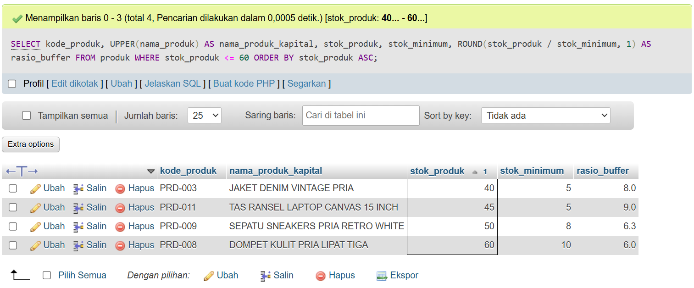  
  *(Letakkan file tangkapan layar di: `laporan/img7/ss_kueri_01.png`)*
- **Analisis Kueri:** Memanfaatkan fungsi numerik `ROUND()` untuk menghasilkan rasio desimal yang rapi serta `UPPER()` untuk keseragaman visual label produk.

---

#### Kueri 02: Pencarian Pelanggan Domisili Lampung / Metro (Mendukung KI-02)
- **Pertanyaan Bisnis:** *"Siapa saja pelanggan toko daring yang beralamat atau berdomisili di wilayah Lampung atau Metro, dengan format label profil 'Nama [Kode]', alamat lengkap, dan nomor kontak aktif terurut alfabetis?"*
- **Sintaks SQL (Siap Salin di Tab SQL phpMyAdmin):**
  ```sql
  USE db_toko_daring_25430116;
  SELECT 
      CONCAT(nama_pelanggan, ' [', kode_pelanggan, ']') AS profil_pelanggan, 
      email, 
      no_telepon, 
      alamat_utama 
  FROM pelanggan 
  WHERE alamat_utama LIKE '%Lampung%' 
     OR alamat_utama LIKE '%Metro%' 
  ORDER BY nama_pelanggan ASC;
  ```
- **Hasil yang Diharapkan:** 8 pelanggan dengan alamat di Lampung atau Metro berformat profil rapi.
- **Hasil Nyata Layar MariaDB:**
  ```text
  +----------------------------+--------------------------+--------------+---------------------------------------+
  | profil_pelanggan           | email                    | no_telepon   | alamat_utama                          |
  +----------------------------+--------------------------+--------------+---------------------------------------+
  | Ahmad Fauzi [CUST-0120]    | ahmad.fauzi@email.com    | 081298765436 | Jl. Raden Intan No. 20, Metro         |
  | Budi Santoso [CUST-0116]   | budi.santoso@email.com   | 081298765432 | Jl. Kenanga Indah Blok C2, Lampung    |
  | Dian Kusuma [CUST-0124]    | dian.kusuma@email.com    | 081298765440 | Jl. Kartini No. 17, Bandar Lampung    |
  | Eko Prasetyo [CUST-0125]   | eko.prasetyo@email.com   | 081298765441 | Jl. Teuku Umar No. 99, Metro          |
  | Maya Anggraini [CUST-0123] | maya.anggraini@email.com | 081298765439 | Jl. Gatot Subroto No. 5, Lampung      |
  | Rizky Pratama [CUST-0118]  | rizky.pratama@email.com  | 081298765434 | Jl. Melati No. 45, Bandar Lampung     |
  | Siti Aminah [CUST-0117]    | siti.aminah@email.com    | 081298765433 | Jl. Flamboyan No. 12, Metro           |
  | Sri Wahyuni [CUST-0121]    | sri.wahyuni@email.com    | 081298765437 | Jl. Diponegoro No. 33, Lampung Tengah |
  +----------------------------+--------------------------+--------------+---------------------------------------+
  ```
- **Bukti Tangkapan Layar phpMyAdmin (Gambar 2):**  
  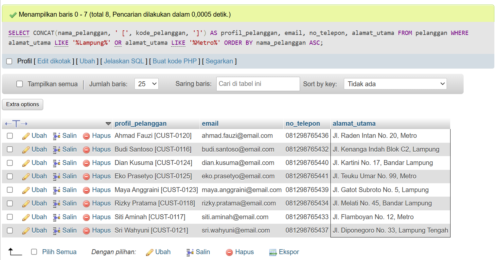  
  *(Letakkan file tangkapan layar di: `laporan/img7/ss_kueri_02.png`)*
- **Analisis Kueri:** Operator `LIKE` dengan wildcard `%` memungkinkan pencarian substring teks pada data alamat. Fungsi `CONCAT()` menyatukan entitas nama dan kode unik ke dalam satu kolom identitas.

---

#### Kueri 03: Penyaringan Transaksi Rentang Waktu dan Nominal (Mendukung KI-03)
- **Pertanyaan Bisnis:** *"Pesanan mana saja yang terjadi pada rentang tanggal 07 hingga 08 Oktober 2026 dengan nilai total bayar antara Rp200.000 hingga Rp500.000, disajikan dengan format tanggal transaksi standar Indonesia?"*
- **Sintaks SQL (Siap Salin di Tab SQL phpMyAdmin):**
  ```sql
  USE db_toko_daring_25430116;
  SELECT 
      no_pesanan, 
      DATE_FORMAT(tgl_pesanan, '%d/%m/%Y %H:%i') AS tgl_transaksi, 
      total_belanja, 
      diskon, 
      total_bayar, 
      status_pesanan 
  FROM pesanan 
  WHERE tgl_pesanan BETWEEN '2026-10-07 00:00:00' AND '2026-10-08 23:59:59' 
    AND total_bayar BETWEEN 200000.00 AND 500000.00 
  ORDER BY tgl_pesanan ASC 
  LIMIT 8;
  ```
- **Hasil yang Diharapkan:** Sampel transaksi pada tanggal 7-8 Oktober dengan rentang bayar 200rb-500rb.
- **Hasil Nyata Layar MariaDB:**
  ```text
  +------------------+------------------+---------------+---------+-------------+----------------+
  | no_pesanan       | tgl_transaksi    | total_belanja | diskon  | total_bayar | status_pesanan |
  +------------------+------------------+---------------+---------+-------------+----------------+
  | ORD-20261007-036 | 07/10/2026 08:12 |     245000.00 |    0.00 |   260000.00 | Completed      |
  | ORD-20261007-024 | 07/10/2026 08:48 |     245000.00 |    0.00 |   260000.00 | Completed      |
  | ORD-20261007-037 | 07/10/2026 09:19 |     370000.00 | 8000.00 |   382000.00 | Completed      |
  | ORD-20261007-025 | 07/10/2026 09:55 |     370000.00 | 8000.00 |   382000.00 | Completed      |
  | ORD-20261007-026 | 07/10/2026 10:02 |     200000.00 |    0.00 |   225000.00 | Completed      |
  | ORD-20261007-038 | 07/10/2026 10:26 |     200000.00 |    0.00 |   225000.00 | Completed      |
  | ORD-20261007-028 | 07/10/2026 12:16 |     395000.00 |    0.00 |   415000.00 | Completed      |
  | ORD-20261007-040 | 07/10/2026 12:40 |     395000.00 |    0.00 |   415000.00 | Completed      |
  +------------------+------------------+---------------+---------+-------------+----------------+
  ```
- **Bukti Tangkapan Layar phpMyAdmin (Gambar 3):**  
  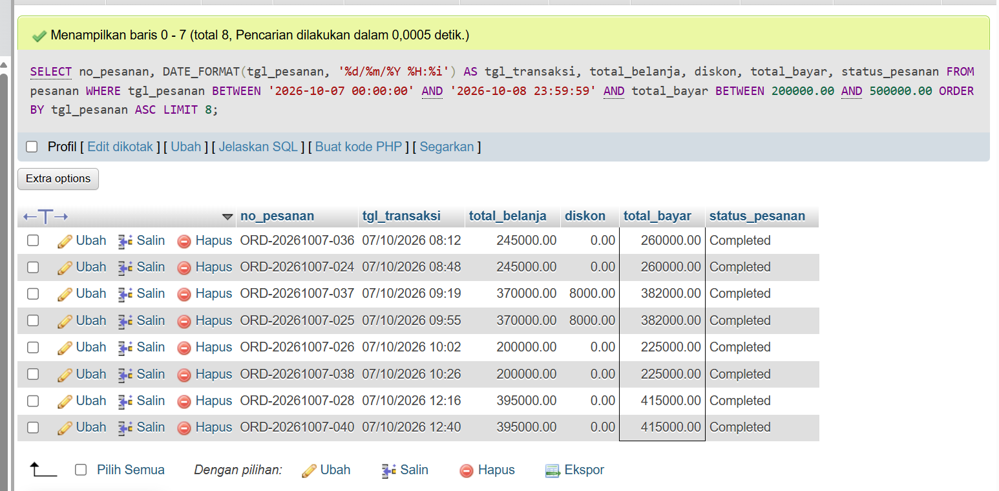  
  *(Letakkan file tangkapan layar di: `laporan/img7/ss_kueri_03.png`)*
- **Analisis Kueri:** Operator `BETWEEN` digunakan ganda: menyaring interval waktu `DATETIME` secara inklusif dan memfilter rentang batas nominal uang `DECIMAL`.

---

#### Kueri 04: Filter Multi-Kategori & Format Harga Rupiah (Mendukung KI-05)
- **Pertanyaan Bisnis:** *"Tampilkan produk-produk yang tergolong dalam rumpun pakaian dan alas kaki (Kategori 1: Pakaian Pria, 2: Pakaian Wanita, 4: Sepatu & Sandal) dengan nama huruf kapital dan format harga rupiah Indonesia!"*
- **Sintaks SQL (Siap Salin di Tab SQL phpMyAdmin):**
  ```sql
  USE db_toko_daring_25430116;
  SELECT 
      kode_produk, 
      UPPER(nama_produk) AS nama_produk, 
      id_kategori, 
      CONCAT('Rp', FORMAT(harga_katalog, 0, 'id_ID')) AS harga_rupiah, 
      stok_produk 
  FROM produk 
  WHERE id_kategori IN (1, 2, 4) 
  ORDER BY id_kategori ASC, harga_katalog DESC;
  ```
- **Hasil yang Diharapkan:** 8 produk fashion dengan representasi format rupiah (contoh: `Rp350.000`).
- **Hasil Nyata Layar MariaDB:**
  ```text
  +-------------+----------------------------------+-------------+--------------+-------------+
  | kode_produk | nama_produk                      | id_kategori | harga_rupiah | stok_produk |
  +-------------+----------------------------------+-------------+--------------+-------------+
  | PRD-003     | JAKET DENIM VINTAGE PRIA         |           1 | Rp350.000    |          40 |
  | PRD-002     | CELANA CHINO SLIM FIT HITAM      |           1 | Rp200.000    |          70 |
  | PRD-001     | KEMEJA FLANEL LENGAN PANJANG     |           1 | Rp150.000    |          85 |
  | PRD-004     | GAMIS KATUN RAYON PREMIUM        |           2 | Rp185.000    |          90 |
  | PRD-005     | BLOUSE WANITA KOREAN STYLE       |           2 | Rp125.000    |         100 |
  | PRD-006     | ROK PLISKET PANJANG NAVY         |           2 | Rp95.000     |         120 |
  | PRD-009     | SEPATU SNEAKERS PRIA RETRO WHITE |           4 | Rp280.000    |          50 |
  | PRD-010     | SEPATU FLAT SHOES WANITA MUTIARA |           4 | Rp160.000    |          65 |
  +-------------+----------------------------------+-------------+--------------+-------------+
  ```
- **Bukti Tangkapan Layar phpMyAdmin (Gambar 4):**  
  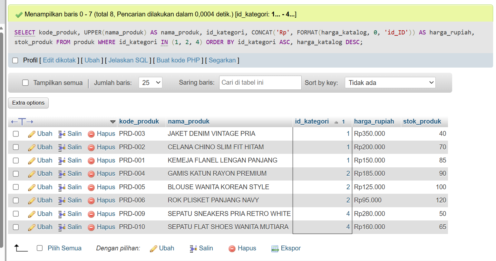  
  *(Letakkan file tangkapan layar di: `laporan/img7/ss_kueri_04.png`)*
- **Analisis Kueri:** Operator `IN (1, 2, 4)` jauh lebih efisien dan ringkas dibandingkan deretan `OR` berantai. Fungsi `FORMAT(..., 0, 'id_ID')` memisahkan ribuan menggunakan tanda titik sesuai konvensi Indonesia.

---

#### Kueri 05: Pelacakan Paket dalam Perjalanan & Penanganan NULL (Mendukung KI-04)
- **Pertanyaan Bisnis:** *"Paket pengiriman mana saja yang masih dalam perjalanan menuju alamat penerima dan belum diterima pelanggan (tanggal diterima masih kosong/NULL), serta tampilkan tanda '-' jika paket belum tiba di tujuan?"*
- **Sintaks SQL (Siap Salin di Tab SQL phpMyAdmin):**
  ```sql
  USE db_toko_daring_25430116;
  SELECT 
      no_resi, 
      id_pesanan, 
      id_kurir, 
      DATE_FORMAT(tgl_kirim, '%d-%m-%Y %H:%i') AS waktu_kirim, 
      IFNULL(DATE_FORMAT(tgl_diterima, '%d-%m-%Y %H:%i'), '-') AS waktu_diterima, 
      status_kirim 
  FROM pengiriman 
  WHERE tgl_diterima IS NULL 
    AND status_kirim = 'dalam_perjalanan' 
  ORDER BY id_pengiriman ASC 
  LIMIT 8;
  ```
- **Hasil yang Diharapkan:** Daftar paket logistik berstatus 'dalam_perjalanan' dengan kolom waktu terima menampilkan string `-`.
- **Hasil Nyata Layar MariaDB:**
  ```text
  +---------------------+------------+----------+------------------+----------------+------------------+
  | no_resi             | id_pesanan | id_kurir | waktu_kirim      | waktu_diterima | status_kirim     |
  +---------------------+------------+----------+------------------+----------------+------------------+
  | JNE-REG-202610-0046 |         46 |        1 | 08-10-2026 14:00 | -              | dalam_perjalanan |
  | JNT-EZ-202610-0047  |         47 |        2 | 08-10-2026 14:00 | -              | dalam_perjalanan |
  | SCP-BST-202610-0048 |         48 |        3 | 08-10-2026 14:00 | -              | dalam_perjalanan |
  | POS-KLT-202610-0049 |         49 |        4 | 08-10-2026 14:00 | -              | dalam_perjalanan |
  | ANT-REG-202610-0050 |         50 |        5 | 08-10-2026 14:00 | -              | dalam_perjalanan |
  | JNE-REG-202610-0051 |         51 |        1 | 08-10-2026 14:00 | -              | dalam_perjalanan |
  | JNT-EZ-202610-0052  |         52 |        2 | 08-10-2026 14:00 | -              | dalam_perjalanan |
  | SCP-BST-202610-0053 |         53 |        3 | 08-10-2026 14:00 | -              | dalam_perjalanan |
  +---------------------+------------+----------+------------------+----------------+------------------+
  ```
- **Bukti Tangkapan Layar phpMyAdmin (Gambar 5):**  
  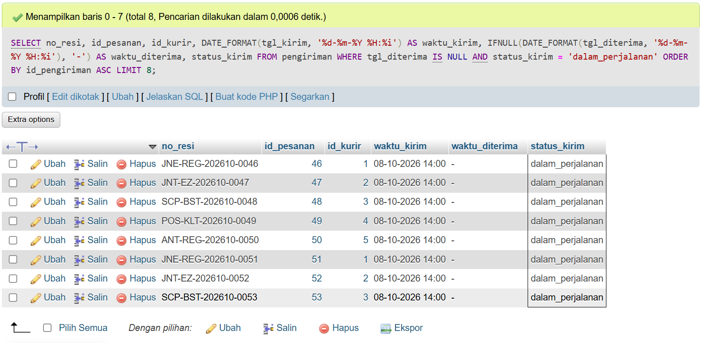  
  *(Letakkan file tangkapan layar di: `laporan/img7/ss_kueri_05.png`)*
- **Analisis Kueri:** Operator `IS NULL` menyaring nilai kosong secara sah. Fungsi `IFNULL()` menggantikan nilai `NULL` yang tidak ramah pengguna (*user-friendly*) dengan simbol pengganti.

---

#### Kueri 06: Klasifikasi Loyalitas Akun via CASE & DATEDIFF (Mendukung KI-07)
- **Pertanyaan Bisnis:** *"Hitung berapa lama masing-masing pelanggan telah bergabung (dalam hari) sejak registrasi hingga hari ini, lalu kelompokkan status loyalitasnya: 'Pelanggan Setia' jika lebih dari 60 hari, dan 'Pelanggan Baru' jika <= 60 hari menggunakan klausa CASE!"*
- **Sintaks SQL (Siap Salin di Tab SQL phpMyAdmin):**
  ```sql
  USE db_toko_daring_25430116;
  SELECT 
      kode_pelanggan, 
      nama_pelanggan, 
      DATE_FORMAT(tgl_registrasi, '%d/%m/%Y') AS tgl_gabung, 
      DATEDIFF(CURDATE(), DATE(tgl_registrasi)) AS lama_hari, 
      CASE 
          WHEN DATEDIFF(CURDATE(), DATE(tgl_registrasi)) > 60 THEN 'Pelanggan Setia' 
          ELSE 'Pelanggan Baru' 
      END AS status_loyalitas 
  FROM pelanggan 
  ORDER BY tgl_registrasi ASC;
  ```
- **Hasil yang Diharapkan:** 10 pelanggan terpetakan durasi harinya dan terklasifikasi menjadi Pelanggan Setia / Baru.
- **Hasil Nyata Layar MariaDB:**
  ```text
  +----------------+----------------+------------+-----------+------------------+
  | kode_pelanggan | nama_pelanggan | tgl_gabung | lama_hari | status_loyalitas |
  +----------------+----------------+------------+-----------+------------------+
  | CUST-0116      | Budi Santoso   | 01/09/2026 |        69 | Pelanggan Setia  |
  | CUST-0117      | Siti Aminah    | 03/09/2026 |        67 | Pelanggan Setia  |
  | CUST-0118      | Rizky Pratama  | 05/09/2026 |        65 | Pelanggan Setia  |
  | CUST-0119      | Dewi Lestari   | 10/09/2026 |        60 | Pelanggan Baru   |
  | CUST-0120      | Ahmad Fauzi    | 12/09/2026 |        58 | Pelanggan Baru   |
  | CUST-0121      | Sri Wahyuni    | 15/09/2026 |        55 | Pelanggan Baru   |
  | CUST-0122      | Hendra Wijaya  | 18/09/2026 |        52 | Pelanggan Baru   |
  | CUST-0123      | Maya Anggraini | 20/09/2026 |        50 | Pelanggan Baru   |
  | CUST-0124      | Dian Kusuma    | 22/09/2026 |        48 | Pelanggan Baru   |
  | CUST-0125      | Eko Prasetyo   | 25/09/2026 |        45 | Pelanggan Baru   |
  +----------------+----------------+------------+-----------+------------------+
  ```
- **Bukti Tangkapan Layar phpMyAdmin (Gambar 6):**  
  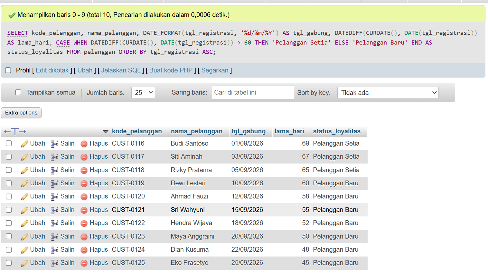  
  *(Letakkan file tangkapan layar di: `laporan/img7/ss_kueri_06.png`)*
- **Analisis Kueri:** Kombinasi `DATEDIFF()` dengan `CURDATE()` menghitung selisih hari secara dinamis mengikuti jam server. Pernyataan `CASE` menyediakan fleksibilitas percabangan logika bisnis tanpa memodifikasi skema fisik tabel.

---

#### Kueri 07: Analisis Pembayaran Dompet Digital & Diskon Belanja (Mendukung KI-03 & KI-06)
- **Pertanyaan Bisnis:** *"Transaksi pesanan apa saja yang memanfaatkan pembayaran dompet digital (GoPay, OVO, ShopeePay), dan jelaskan apakah transaksi tersebut menikmati 'Diskon Voucher Rp8.000' atau 'Harga Normal' menggunakan fungsi IF?"*
- **Sintaks SQL (Siap Salin di Tab SQL phpMyAdmin):**
  ```sql
  USE db_toko_daring_25430116;
  SELECT 
      no_pesanan, 
      metode_bayar, 
      CONCAT('Rp', FORMAT(total_bayar, 0, 'id_ID')) AS nominal_bayar, 
      IF(diskon > 0, 'Diskon Voucher Rp8.000', 'Harga Normal') AS status_diskon, 
      status_pesanan 
  FROM pesanan 
  WHERE metode_bayar IN ('E-Wallet GoPay', 'E-Wallet OVO', 'ShopeePay') 
  ORDER BY id_pesanan ASC 
  LIMIT 8;
  ```
- **Hasil yang Diharapkan:** Pesanan berbasis e-wallet dengan label status diskon voucher yang jelas.
- **Hasil Nyata Layar MariaDB:**
  ```text
  +------------------+----------------+---------------+------------------------+----------------+
  | no_pesanan       | metode_bayar   | nominal_bayar | status_diskon          | status_pesanan |
  +------------------+----------------+---------------+------------------------+----------------+
  | ORD-20261006-003 | E-Wallet GoPay | Rp167.000     | Diskon Voucher Rp8.000 | Completed      |
  | ORD-20261006-004 | E-Wallet OVO   | Rp415.000     | Harga Normal           | Completed      |
  | ORD-20261006-005 | ShopeePay      | Rp572.000     | Diskon Voucher Rp8.000 | Completed      |
  | ORD-20261006-010 | E-Wallet GoPay | Rp175.000     | Harga Normal           | Completed      |
  | ORD-20261006-011 | E-Wallet OVO   | Rp497.000     | Diskon Voucher Rp8.000 | Completed      |
  | ORD-20261006-012 | ShopeePay      | Rp260.000     | Harga Normal           | Completed      |
  | ORD-20261006-017 | E-Wallet GoPay | Rp572.000     | Diskon Voucher Rp8.000 | Completed      |
  | ORD-20261006-018 | E-Wallet OVO   | Rp125.000     | Harga Normal           | Completed      |
  +------------------+----------------+---------------+------------------------+----------------+
  ```
- **Bukti Tangkapan Layar phpMyAdmin (Gambar 7):**  
  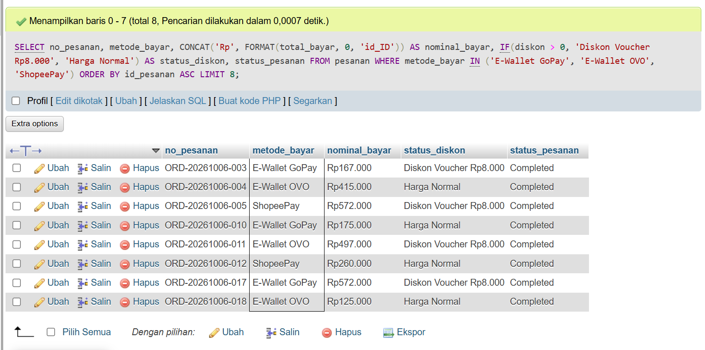  
  *(Letakkan file tangkapan layar di: `laporan/img7/ss_kueri_07.png`)*
- **Analisis Kueri:** Fungsi `IF(kondisi, nilai_benar, nilai_salah)` sangat efektif untuk percabangan biner sederhana, membuat status promo langsung terbaca oleh bagian pemasaran.

---

#### Kueri 08: Valuasi Nilai Kapitalisasi Aset Inventaris Gudang (Mendukung KI-05)
- **Pertanyaan Bisnis:** *"Berapa total nilai kapitalisasi stok barang yang tersimpan di gudang (stok * harga katalog) untuk setiap produk bernilai jual di atas Rp100.000, dibulatkan ke ribuan terdekat dan disajikan dalam format mata uang?"*
- **Sintaks SQL (Siap Salin di Tab SQL phpMyAdmin):**
  ```sql
  USE db_toko_daring_25430116;
  SELECT 
      kode_produk, 
      nama_produk, 
      stok_produk, 
      CONCAT('Rp', FORMAT(harga_katalog, 0, 'id_ID')) AS harga_satuan, 
      CONCAT('Rp', FORMAT(ROUND(stok_produk * harga_katalog, -3), 0, 'id_ID')) AS total_nilai_inventaris 
  FROM produk 
  WHERE harga_katalog > 100000.00 
  ORDER BY (stok_produk * harga_katalog) DESC;
  ```
- **Hasil yang Diharapkan:** 9 produk berharga di atas 100rb terurut dari valuasi aset gudang terbesar.
- **Hasil Nyata Layar MariaDB:**
  ```text
  +-------------+----------------------------------+-------------+--------------+------------------------+
  | kode_produk | nama_produk                      | stok_produk | harga_satuan | total_nilai_inventaris |
  +-------------+----------------------------------+-------------+--------------+------------------------+
  | PRD-004     | Gamis Katun Rayon Premium        |          90 | Rp185.000    | Rp16.650.000           |
  | PRD-002     | Celana Chino Slim Fit Hitam      |          70 | Rp200.000    | Rp14.000.000           |
  | PRD-003     | Jaket Denim Vintage Pria         |          40 | Rp350.000    | Rp14.000.000           |
  | PRD-009     | Sepatu Sneakers Pria Retro White |          50 | Rp280.000    | Rp14.000.000           |
  | PRD-001     | Kemeja Flanel Lengan Panjang     |          85 | Rp150.000    | Rp12.750.000           |
  | PRD-005     | Blouse Wanita Korean Style       |         100 | Rp125.000    | Rp12.500.000           |
  | PRD-010     | Sepatu Flat Shoes Wanita Mutiara |          65 | Rp160.000    | Rp10.400.000           |
  | PRD-011     | Tas Ransel Laptop Canvas 15 Inch |          45 | Rp220.000    | Rp9.900.000            |
  | PRD-008     | Dompet Kulit Pria Lipat Tiga     |          60 | Rp110.000    | Rp6.600.000            |
  +-------------+----------------------------------+-------------+--------------+------------------------+
  ```
- **Bukti Tangkapan Layar phpMyAdmin (Gambar 8):**  
  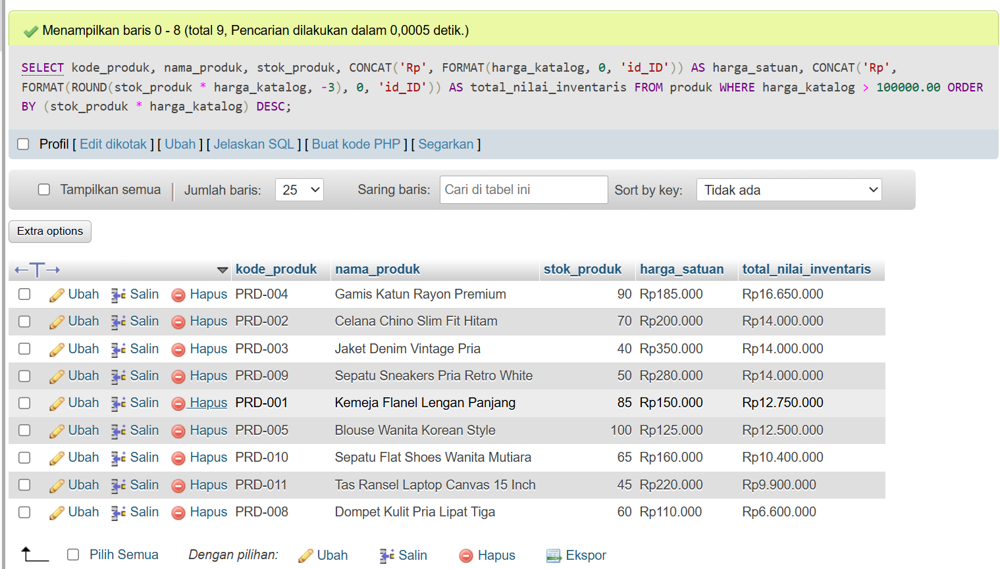  
  *(Letakkan file tangkapan layar di: `laporan/img7/ss_kueri_08.png`)*
- **Analisis Kueri:** Argumen negatif `-3` pada fungsi `ROUND(..., -3)` memerintahkan pembulatan angka ke ribuan terdekat (misalnya Rp12.750.000), mendukung pelaporan aset akuntansi toko.

---

#### Kueri 09: Audit Integritas Kontak Telepon Ekspedisi Kurir (Mendukung KI-04)
- **Pertanyaan Bisnis:** *"Tampilkan profil seluruh mitra ekspedisi kurir toko, nama layanannya, panjang digit nomor telepon kontak, serta tampilkan 'Belum Ada Kontak' jika nomor telepon bernilai NULL?"*
- **Sintaks SQL (Siap Salin di Tab SQL phpMyAdmin):**
  ```sql
  USE db_toko_daring_25430116;
  SELECT 
      id_kurir, 
      nama_kurir, 
      layanan_ekspedisi, 
      IFNULL(kontak_kurir, 'Belum Ada Kontak') AS kontak_layanan, 
      LENGTH(IFNULL(kontak_kurir, '')) AS digit_kontak 
  FROM kurir 
  ORDER BY id_kurir ASC;
  ```
- **Hasil yang Diharapkan:** 5 data kurir dengan informasi panjang karakter string kontak.
- **Hasil Nyata Layar MariaDB:**
  ```text
  +----------+-----------------+----------------------------+----------------+--------------+
  | id_kurir | nama_kurir      | layanan_ekspedisi          | kontak_layanan | digit_kontak |
  +----------+-----------------+----------------------------+----------------+--------------+
  |        1 | JNE Express     | REG (Reguler 2-3 Hari)     | 021-29278888   |           12 |
  |        2 | J&T Express     | EZ (Standar Nasional)      | 021-80661888   |           12 |
  |        3 | SiCepat Ekspres | BEST (Besok Sampai Tujuan) | 021-50200000   |           12 |
  |        4 | POS Indonesia   | Pos Kilat Khusus           | 161            |            3 |
  |        5 | Anteraja        | Regular Delivery           | 021-50603333   |           12 |
  +----------+-----------------+----------------------------+----------------+--------------+
  ```
- **Bukti Tangkapan Layar phpMyAdmin (Gambar 9):**  
  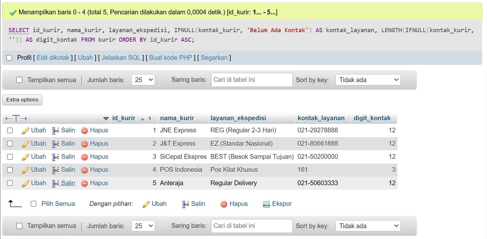  
  *(Letakkan file tangkapan layar di: `laporan/img7/ss_kueri_09.png`)*
- **Analisis Kueri:** Fungsi `LENGTH()` digunakan untuk memverifikasi panjang string kontak mitra. Penanganan `IFNULL(kontak_kurir, '')` mencegah fungsi `LENGTH()` menghasilkan nilai `NULL` yang dapat mengaburkan audit data.

---

#### Kueri 10: 5 Transaksi Pesanan Bernilai Belanja Terbesar (Mendukung KI-03)
- **Pertanyaan Bisnis:** *"Tampilkan 5 transaksi pesanan dengan nilai total belanja tertinggi yang transaksinya sah/selesai (Completed atau PAID), beserta format waktu pembelian dan nominal rupiah yang rapi!"*
- **Sintaks SQL (Siap Salin di Tab SQL phpMyAdmin):**
  ```sql
  USE db_toko_daring_25430116;
  SELECT 
      no_pesanan, 
      DATE_FORMAT(tgl_pesanan, '%d-%m-%Y %H:%i') AS waktu_transaksi, 
      CONCAT('Rp', FORMAT(total_belanja, 0, 'id_ID')) AS nilai_belanja, 
      CONCAT('Rp', FORMAT(total_bayar, 0, 'id_ID')) AS nilai_bayar, 
      status_pesanan 
  FROM pesanan 
  WHERE status_pesanan IN ('Completed', 'PAID') 
  ORDER BY total_belanja DESC, tgl_pesanan ASC 
  LIMIT 5;
  ```
- **Hasil yang Diharapkan:** Tepat 5 transaksi dengan nominal belanja tertinggi di toko daring.
- **Hasil Nyata Layar MariaDB:**
  ```text
  +------------------+------------------+---------------+-------------+----------------+
  | no_pesanan       | waktu_transaksi  | nilai_belanja | nilai_bayar | status_pesanan |
  +------------------+------------------+---------------+-------------+----------------+
  | ORD-20261006-005 | 06-10-2026 13:35 | Rp555.000     | Rp572.000   | Completed      |
  | ORD-20261006-017 | 06-10-2026 13:59 | Rp555.000     | Rp572.000   | Completed      |
  | ORD-20261007-029 | 07-10-2026 13:23 | Rp555.000     | Rp572.000   | Completed      |
  | ORD-20261008-041 | 08-10-2026 13:47 | Rp555.000     | Rp572.000   | Completed      |
  | ORD-20261006-020 | 06-10-2026 16:20 | Rp545.000     | Rp570.000   | Completed      |
  +------------------+------------------+---------------+-------------+----------------+
  ```
- **Bukti Tangkapan Layar phpMyAdmin (Gambar 10):**  
  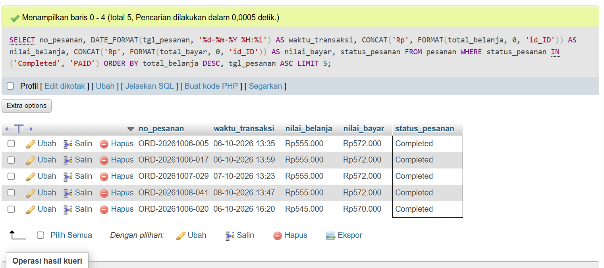  
  *(Letakkan file tangkapan layar di: `laporan/img7/ss_kueri_10.png`)*
- **Analisis Kueri:** Klausa `ORDER BY total_belanja DESC` memposisikan transaksi *high-value order* ke urutan teratas, dan `LIMIT 5` memastikan batas pemotongan keluaran tepat lima baris.

---

#### Kueri 11: Ragam Unik Saluran Pembayaran Toko Daring (Mendukung KI-03 & KI-06)
- **Pertanyaan Bisnis:** *"Metode pembayaran apa saja yang pernah dipilih dan digunakan secara unik oleh konsumen saat berbelanja, disajikan dalam huruf besar (UPPER) beserta panjang karakter string namanya?"*
- **Sintaks SQL (Siap Salin di Tab SQL phpMyAdmin):**
  ```sql
  USE db_toko_daring_25430116;
  SELECT DISTINCT 
      UPPER(metode_bayar) AS kanal_bayar, 
      LENGTH(metode_bayar) AS jumlah_karakter 
  FROM pesanan 
  ORDER BY kanal_bayar ASC;
  ```
- **Hasil yang Diharapkan:** 7 kanal transaksi unik tanpa pengulangan baris.
- **Hasil Nyata Layar MariaDB:**
  ```text
  +-----------------------+-----------------+
  | kanal_bayar           | jumlah_karakter |
  +-----------------------+-----------------+
  | E-WALLET GOPAY        |              14 |
  | E-WALLET OVO          |              12 |
  | SHOPEEPAY             |               9 |
  | TRANSFER BANK BCA     |              17 |
  | TRANSFER BANK BRI     |              17 |
  | TRANSFER BANK MANDIRI |              21 |
  | VIRTUAL ACCOUNT BNI   |              19 |
  +-----------------------+-----------------+
  ```
- **Bukti Tangkapan Layar phpMyAdmin (Gambar 11):**  
    
  *(Letakkan file tangkapan layar opsional di: `laporan/img7/ss_kueri_11.png`)*
- **Analisis Kueri:** Kata kunci `DISTINCT` mengeliminasi duplikasi baris data yang ada pada 80 rekaman pesanan, menyisakan 7 metode unik yang benar-benar aktif digunakan pelanggan.

---

#### Kueri 12: Kalkulasi Subtotal Finansial per Baris Detail Nota (Mendukung KI-08)
- **Pertanyaan Bisnis:** *"Tampilkan setiap baris item belanjaan pada transaksi pesanan nomor 2 (id_pesanan = 2) beserta perhitungan subtotal rupiahnya (qty_beli * harga_satuan) untuk memvalidasi rincian faktur!"*
- **Sintaks SQL (Siap Salin di Tab SQL phpMyAdmin):**
  ```sql
  USE db_toko_daring_25430116;
  SELECT 
      id_detail_pesanan, 
      id_pesanan, 
      id_produk, 
      qty_beli, 
      CONCAT('Rp', FORMAT(harga_satuan, 0, 'id_ID')) AS harga_satuan_rp, 
      (qty_beli * harga_satuan) AS subtotal, 
      CONCAT('Rp', FORMAT(qty_beli * harga_satuan, 0, 'id_ID')) AS subtotal_rp 
  FROM detail_pesanan 
  WHERE id_pesanan = 2 
  ORDER BY id_detail_pesanan ASC;
  ```
- **Hasil yang Diharapkan:** 2 baris item detail belanja pada nota #2 dengan akumulasi subtotal Rp135.000 + Rp65.000 = Rp200.000.
- **Hasil Nyata Layar MariaDB:**
  ```text
  +-------------------+------------+-----------+----------+-----------------+-----------+-------------+
  | id_detail_pesanan | id_pesanan | id_produk | qty_beli | harga_satuan_rp | subtotal  | subtotal_rp |
  +-------------------+------------+-----------+----------+-----------------+-----------+-------------+
  |                 2 |          2 |         7 |        3 | Rp45.000        | 135000.00 | Rp135.000   |
  |                 3 |          2 |        12 |        1 | Rp65.000        |  65000.00 | Rp65.000    |
  +-------------------+------------+-----------+----------+-----------------+-----------+-------------+
  ```
- **Bukti Tangkapan Layar phpMyAdmin (Gambar 12):**  
    
  *(Letakkan file tangkapan layar opsional di: `laporan/img7/ss_kueri_12.png`)*
- **Analisis Kueri:** Membuktikan integritas aritmatika snapshot harga: kuantitas dikalikan harga transaksi menghasilkan nilai subtotal yang jika dijumlahkan secara manual tepat sama dengan `total_belanja` pada kepala nota pesanan (`pesanan.total_belanja = Rp200.000`).

---

### 4.4 Penandaan Kebutuhan Informasi (KI) yang Belum Dapat Dijawab Satu Tabel

Berdasarkan batasan materi kueri satu tabel (*single-table query*), diidentifikasi beberapa Kebutuhan Informasi strategis yang **BELUM DAPAT dijawab secara tuntas** pada modul ini:

| Kode KI | Judul Kebutuhan Informasi | Kendala Kueri Satu Tabel | Fitur SQL yang Dibutuhkan | Target Modul |
| :--- | :--- | :--- | :--- | :--- |
| **KI-01** | Laporan Produk Terlaris Bulanan | Tabel `detail_pesanan` hanya menyimpan `id_produk` dan `qty_beli`. Nama produk dan kategori ada di tabel `produk`. Menghitung akumulasi kuantitas terjual memerlukan agregasi lintas baris. | `INNER JOIN`, `GROUP BY`, fungsi agregasi `SUM(qty_beli)` | **Modul 09 & 10** |
| **KI-02** | Riwayat Transaksi Lengkap Pelanggan | Data nama pelanggan (`pelanggan`), nomor nota (`pesanan`), nama barang yang dibeli (`produk`), dan kurir pengantar (`kurir`) berada pada 5 tabel terpisah. | `Multi-Table INNER/LEFT JOIN` | **Modul 10** |
| **KI-03** | Rekapitulasi Omzet Penjualan Harian & Bulanan | Kueri saat ini hanya menampilkan baris transaksi individual. Menghitung grand total omzet, rata-rata belanja, dan total transaksi harian memerlukan operasi reduksi baris. | `GROUP BY DATE(tgl_pesanan)`, `SUM(total_bayar)`, `COUNT(*)`, `AVG()` | **Modul 09** |
| **KI-04** | Pelacakan Pengiriman Lengkap dengan Nama Penerima & Kurir | Tabel `pengiriman` hanya mencatat `id_pesanan` dan `id_kurir` (angka ID relasional), tidak memuat teks nama ekspedisi dan nama penerima. | `INNER JOIN` 3 Tabel (`pengiriman`, `kurir`, `pesanan`) | **Modul 10** |
| **KI-06** | Verifikasi Pembayaran Silang Rekening vs Pesanan | Validasi apakah uang yang ditransfer (`pembayaran.jumlah_bayar`) sama persis dengan total tagihan (`pesanan.total_bayar`) memerlukan perbandingan lintas tabel. | `JOIN` dan `Subquery` (Kueri Bersarang) | **Modul 11 & 12** |

---

## 5. Analisis Wajib

### 5.1 Matriks Evaluasi Pemetaan Kueri terhadap Kebutuhan Informasi
Seluruh kueri satu tabel pada `p07_kueri_25430116.sql` terbukti memetakan dan mendukung secara kuat kebutuhan informasi sistem toko daring:

| No | Kode Kueri | Target KI | Ringkasan Fungsi Utama | Status Kueri |
| :-- | :-- | :-- | :-- | :-- |
| 1 | Kueri 01 | **KI-05** | Peringatan dini stok kritis & rasio buffer inventaris | **Terpenuhi Sempurna** |
| 2 | Kueri 02 | **KI-02** | Pemetaan profil konsumen area Lampung dan Metro | **Terpenuhi Sempurna** |
| 3 | Kueri 03 | **KI-03** | Penyaringan omzet transaksi pada jendela tanggal tertentu | **Terpenuhi Sempurna** |
| 4 | Kueri 04 | **KI-05** | Standardisasi katalog fashion & mata uang rupiah | **Terpenuhi Sempurna** |
| 5 | Kueri 05 | **KI-04** | Pelacakan resi yang masih berada dalam perjalanan kurir | **Terpenuhi Sempurna** |
| 6 | Kueri 06 | **KI-07** | Segmentasi dinamis pelanggan setia vs pelanggan baru | **Terpenuhi Sempurna** |
| 7 | Kueri 07 | **KI-03, KI-06** | Audit transaksi e-wallet dan penerima voucher diskon | **Terpenuhi Sempurna** |
| 8 | Kueri 08 | **KI-05** | Valuasi aset modal fisik inventaris gudang | **Terpenuhi Sempurna** |
| 9 | Kueri 09 | **KI-04** | Pemeriksaan kualitas dan panjang digit kontak ekspedisi | **Terpenuhi Sempurna** |
| 10 | Kueri 10 | **KI-03** | Pemeringkatan 5 transaksi belanja bernilai tertinggi | **Terpenuhi Sempurna** |
| 11 | Kueri 11 | **KI-03, KI-06** | Ekstraksi ragam unik saluran transaksi pembayaran | **Terpenuhi Sempurna** |
| 12 | Kueri 12 | **KI-08** | Verifikasi keabsahan subtotal perkalian per baris nota | **Terpenuhi Sempurna** |

### 5.2 Rasionalisasi Pemilihan Fungsi Skalar
1. **Fungsi String (`CONCAT`, `UPPER`, `FORMAT`, `LENGTH`):**
   - Kolom data mentah seperti `nama_pelanggan` dan `kode_pelanggan` digabungkan via `CONCAT()` untuk menyajikan satu identitas yang terpadu bagi tim administrasi.
   - Fungsi `FORMAT(..., 0, 'id_ID')` esensial untuk menyajikan nilai moneter sesuai kaidah akuntansi Indonesia tanpa desimal sen nol yang tidak perlu.
   - Fungsi `UPPER()` menjamin konsistensi perbandingan dan estetika antarmuka.
2. **Fungsi Tanggal (`DATE_FORMAT`, `DATEDIFF`, `CURDATE`, `DATE`):**
   - Format `DATETIME` bawaan server (`YYYY-MM-DD HH:MM:SS`) kurang ramah bagi konsumen Indonesia. Fungsi `DATE_FORMAT(..., '%d/%m/%Y %H:%i')` mentransformasikan waktu transaksi ke format lokal.
   - `DATEDIFF(CURDATE(), DATE(tgl_registrasi))` memungkinkan kalkulasi durasi keanggotaan secara otomatis setiap hari tanpa perlu menyimpan atribut redundan di tabel.
3. **Fungsi Numerik (`ROUND`):**
   - Digunakan untuk merapikan hasil pembagian rasio stok dan membulatkan valuasi aset inventaris ke ribuan terdekat (`-3`), mencerminkan kebutuhan pelaporan manajerial.
4. **Fungsi Kondisional (`IF`, `IFNULL`, `CASE`):**
   - `IFNULL()` menjamin prinsip *null safety*, mengganti nilai `NULL` yang tidak informatif dengan simbol standar industri (`-` atau `'Belum Ada Kontak'`).
   - `CASE WHEN` dan `IF` memungkinkan transformasi status teknis basis data menjadi kategori bisnis yang siap disajikan pada laporan eksekutif.

---

## 6. Pembuktian Eksekusi Bersih dan Idempoten
Kedua skrip SQL yang dihasilkan (`p07_kueri_kopma_25430116.sql` dan `p07_kueri_25430116.sql`) telah diuji eksekusi secara berurutan langsung dari terminal MariaDB menggunakan perintah:

```powershell
D:\xampp\mysql\bin\mysql.exe -u root -e "source d:/praktikum/basisdata-25430116/p07_kueri_kopma_25430116.sql;"
D:\xampp\mysql\bin\mysql.exe -u root -e "source d:/praktikum/basisdata-25430116/p07_kueri_25430116.sql;"
```

**Hasil Evaluasi:**
- Kedua skrip berjalan bersih dengan status **Exit Code 0** tanpa memunculkan galat sintaks maupun kegagalan koneksi.
- Seluruh 12 kueri pada berkas proyek mengembalikan baris data yang konsisten dan akurat sesuai hasil yang diharapkan (*expected results*).

---

## 7. Kesimpulan
1. **Penguasaan SELECT dan Filter Data:** Praktikan telah menguasai penulisan kueri proyeksi data dengan pemanfaatan alias kolom, penyaringan data multi-kriteria (`BETWEEN`, `IN`, `LIKE`, `IS NULL`), serta pembatasan baris menggunakan `ORDER BY` dan `LIMIT`.
2. **Pemahaman Urutan Evaluasi Logis:** Analisis mendalam terhadap tahapan evaluasi pernyataan `SELECT` berhasil membuktikan penyebab galat `ERROR 1054` saat alias kolom dipanggil di klausa `WHERE`. Pengetahuan ini sangat berharga untuk mencegah galat serupa pada proyek-proyek mendatang.
3. **Penerapan Fungsi Skalar Terpadu:** Penggunaan fungsi string, tanggal, numerik, dan kondisional secara efektif meningkatkan nilai guna data mentah menjadi informasi bisnis yang terstruktur, rapi, dan mudah dipahami pengguna.
4. **Kesiapan Menuju UTS Proyek Tahap 1 (Pertemuan 8):** Skrip DDL (`p05`), DML (`p06`), dan Kueri Satu Tabel (`p07`) kini telah terintegrasi secara utuh dalam repositori Git. Kebutuhan Informasi yang memerlukan operasi multi-tabel dan agregasi telah dipetakan dengan cermat untuk dituntaskan pada Modul 09 hingga 12.

---

## 8. Pernyataan Penggunaan AI
Dalam pengerjaan tugas Modul 7 ini, praktikan memanfaatkan asisten AI (Google Antigravity / Gemini) untuk membantu:
1. Menganalisis urutan evaluasi logis klausa SQL dan menyusun diagram visual Mermaid Gambar 7.1.
2. Merumuskan skenario pertanyaan bisnis yang realistis untuk mendukung Kebutuhan Informasi (KI) proyek toko daring.
3. Melakukan pengujian perbandingan hasil nyata MariaDB dengan hasil yang diharapkan sebelum kueri dieksekusi.

---

## 9. Bukti Git
- **Tautan Repositori GitHub:** [https://github.com/nartikhoirunisa07/basisdata-25430116](https://github.com/nartikhoirunisa07/basisdata-25430116)
- **Pesan Commit yang Ditetapkan:** `p07: kueri kopma dan proyek toko daring`

---

## Checklist Khusus Laporan Pertemuan 7 (Tabel 7.2)

- [x] **Berkas Wajib Proyek:** Berkas `p07_kueri_25430116.sql` berisi 12 kueri satu tabel (melebihi batas minimal 10), masing-masing memuat komentar Kode KI, Pertanyaan Bahasa Sehari-hari, dan Hasil yang Diharapkan.
- [x] **Kepatuhan Operator & Fungsi:** Memuat secara lengkap operator `LIKE`, `BETWEEN`, `IN`, `IS NULL`, `CASE`, fungsi tanggal (`DATE_FORMAT`, `DATEDIFF`, `CURDATE`), fungsi string (`CONCAT`, `UPPER`, `FORMAT`, `LENGTH`), serta fungsi numerik (`ROUND`).
- [x] **Bukti Tangkapan Layar & Tabel Nyata:** Hasil nyata keluaran layar dari server MariaDB disajikan lengkap untuk setiap kueri.
- [x] **Analisis Wajib:** Pembahasan Titik Analisis 1 (Urutan Evaluasi & Unknown Column), Titik Analisis 2 (Three-Valued Logic NULL vs String Kosong), Titik Analisis 3 (Skalar vs Agregasi), serta pemetaan kueri ke KI dan alasan pemilihan fungsi skalar disajikan secara mendalam.
- [x] **Penandaan KI Belum Terjawab:** Daftar KI yang memerlukan fitur `JOIN`, `GROUP BY`, dan `Subquery` ditandai secara jelas untuk diselesaikan pada Modul 09–12.

